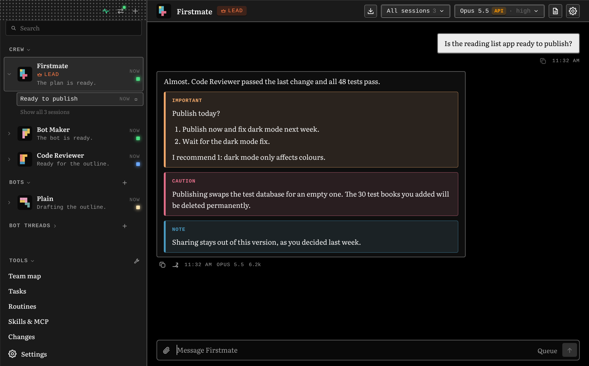
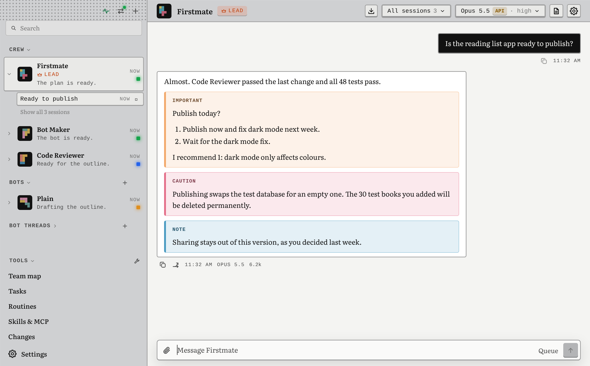

# Build Your Own Harness

See it in the light theme

## Vision

Building and maintaining a custom harness is now convenient, fast and cheap.

Harnesses have become a first-class daily workspace: far too important and too frequently used for a one-size-fits-all approach.

A harness need not be complicated. A minimal harness is a more capable one. Plain folders and files are all it takes to understand and run it.

Anyone who wants to can tailor a harness to their needs, work and ideas.

## Quick start

Give this repository to your coding agent and say: "Build me my own harness from this."

It tells you what the harness needs, sets up the VM, asks you a few questions, then builds and tests your harness. Your agent tells you when you can switch over to your new harness.

## Release

v1.1.0
SHA-256 of vm/SHA256SUMS: 98d9128ceab4ee72cf8577e7ba717c2ce030a4036ed1fbef18e4a5cca8704f8c

## For those who

- dislike bloat
- want to avoid unexpected changes to their harness
- have been working around unwanted harness behaviour
- have been waiting for a feature to be supported
- want control, optionality and portable config files

## What is BYOH?

BYOH is a blueprint for your AI agent to build you a harness. It is a specification, a test suite and a verification kit. Your coding agent builds the harness from them, checks it against the suite, and hands you the source to keep.

You end up with an orchestrator bot (named Firstmate) you talk to. It leads a team of bots that it can create, each one running on Claude Code or Pi. The bots run in a VM, apart from the computer you work on, and you work with them through a desktop app. It has the same shape as Grok Bot, OpenAI Dots and Claude Duet. You choose the name of your harness.

What sets BYOH apart?

- It contains reasons for decisions so you can choose differently. The spec explains its choices, often including what was rejected and why.
- It proves your harness works as intended. The suite runs real Claude Code and Pi processes against a scripted model, with no credentials needed. Your agent can show that the harness it built actually works.

| Folder | What it holds |
| --- | --- |
| `spec/` | One file per feature: the rules, and the reasons behind them |
| `suite/` | Test cases your agent runs against the harness it built |
| `verify/` | The verification skill and shared kit: real-window driving and a scripted model, no credentials needed |
| `vm/` | The virtual machine recipe |
| `starter/` | Firstmate, Bot Maker, Code Reviewer and Plain, a general-purpose bot you can rename |
| `screenshots/` | [Default-look gallery](screenshots/README.md), with the four starter bots |

## Opinions

| BYOH opinion | If you want something different |
| --- | --- |
| Claude Code and Pi are enough. | Have your agent integrate other CLI agents. |
| No permission prompts: they slow you down. Safety comes from the boundary instead: the bots never run on the computer you work on, only in a VM or machine of their own, as their own user, with no shared folders. You approve only the actions that cannot be undone, such as merge, deploy, send and delete. | Have your agent add permission gates. However, the VM is not optional. You can swap our VM for your own Linux machine (see Defaults). |
| One VM shared by all bots. | Have your agent split bots across hosts. |
| The bots get their own GitHub account, so their commits are theirs and your account keeps ownership. You can revoke their access at any time. | Skip it, or decide later during setup. |

## Defaults

| BYOH default | If you have something different |
| --- | --- |
| An Apple Silicon Mac, the only system we prove end to end. | Windows, Linux or an Intel Mac: the spec is plain text and your agent can adapt it (at your own risk). Most of it describes the Linux host the bots run in, which is the same everywhere. What changes is the setup on your side: the VM, the app build, start at login, backup. |
| A Lima VM running Debian 13, sized from your computer's memory (table below). Its disk grows with use, up to 100 GiB, and never shrinks on its own. | Use your own Linux machine (another VM, a VPS, a spare computer) if it passes the host check. We prove only our VM end to end; issues specific to your setup rely on your agent. |
| Both engines: Claude Code on your Claude login, Pi signed in with ChatGPT etc. | Pick one, or use an API key or subscription for a named provider through Pi. |
| An Electron desktop app. | Have your agent build another front end; the app's screen tests then no longer apply. |
| No backup by default: deleting the VM deletes your harness data. | Turn on VM backup during setup: your computer pulls a copy into a private repo. See [spec/vm-backup.md](spec/vm-backup.md). |

| Your computer's memory | VM memory | Left for you | Bots working at once |
| --- | --- | --- | --- |
| 8 GB | not recommended (3 GB if you insist; stop the VM when idle) | 5 GB | 1-2 |
| 16 GB | 4 GB | 12 GB | 2-4 |
| 24 GB | 6 GB | 18 GB | 4-8 |
| 32 GB | 8 GB | 24 GB | 8-12 |
| 48 GB or more | 8 GB | 40 GB or more | 8-12 |

The VM holds its memory while it runs. You can resize it later with a restart.

## Credits

The Firstmate idea and implementation are borrowed from Kun Chen's [Firstmate](https://github.com/kunchenguid/firstmate), with gratitude!
Notice: [starter/NOTICE.md](starter/NOTICE.md).

## Licence

[MIT-0](LICENSE). The files listed in [starter/NOTICE.md](starter/NOTICE.md) stay under their MIT licence.

## FAQ

**Is BYOH compliant with Anthropic's and OpenAI's terms of service?**

BYOH runs Claude subscriptions only through the official Claude Code, and OpenAI sign-in only through Pi, which OpenAI lists as a supported integration.

**Which coding agent do I need?**

You can use any coding agent, but we recommend one running a frontier model. It starts on your computer, then continues the interview and build inside the isolated Linux host.

**Do I need to be a developer? What do I have to do by hand?**

You name your harness, answer a few questions and sign in to each engine you choose (Claude Code on your Claude login, Pi signed in with ChatGPT etc.). Your agent also gives you the setup commands and messages to paste.

**Do I need both Anthropic and OpenAI subscriptions?**

No. Both engines are the default, but you can choose just one, or use an API key for a named provider through Pi instead. Claude subscriptions go through Claude Code; ChatGPT sign-in goes through Pi.

**With no permission prompts, what stops a bot from doing damage?**

The boundary limits the damage: bots run on a separate machine or VM, as a user without admin rights, with none of your personal folders shared in. They can still read, change, delete or send out anything available to their user, including the harness data and its credentials; this is not a guarantee against damage.

**In the default Lima VM setup, can a bot reach my Mac?**

Bots cannot read your Mac's files or keys, and the VM's firewall blocks access to private networks and your Mac's loopback services. There are still trust edges: the desktop app shows content from the bots' side, and app updates run code built from source the bots can change, but nothing new is installed until you approve it.

**Will my harness match someone else's?**

Every harness is generated from scratch, so two builds will have different code. The suite is the only thing that makes them consistent.
