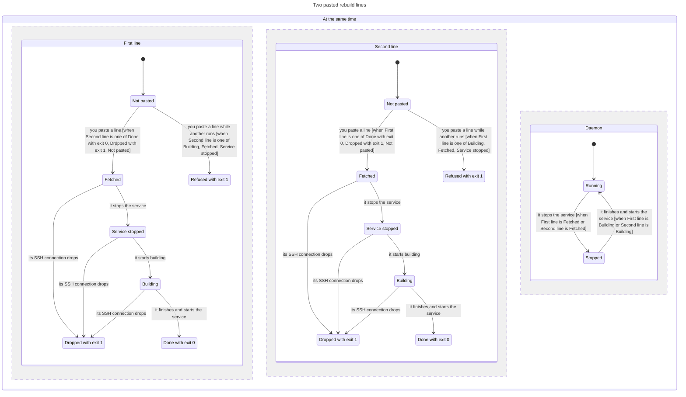

# Rebuild line and desktop app build

Classification: Core. Prerequisites: [host](host.md),
[isolation](isolation.md), [app pairing](app-pairing.md).

## Purpose

Let the person rebuild and restart their harness with one pasted Mac line,
while the host does all the building: the Mac stays at Lima plus one app, with
no Node and no checkout. This section owns the places code lives, the
line, the host half that deploys the daemon and builds the desktop app, the Mac
half that pulls, checks and swaps the app, rollback and replacement errors.
[Isolation](isolation.md) R6 states the trust edge this path carries.

## Required behaviour

- **R1 — Places.** The harness source is the Git repository `~/myharness-src`
  in the bot user's home, built and tested there by the person's agent. The
  deployed code is a separate checkout, `/opt/myharness/src`, and the desktop app
  output is `/opt/myharness/app/out/`; both are owned by the admin account and
  writable by no one else. The deploy program is
  `/usr/local/sbin/myharness-deploy`, owned by root and installed with the host
  from the pinned BYOH tag, so no bot can edit it. The live daemon runs code only
  from the deployed checkout ([VM](vm.md) R7).
- **R2 — The line.** The person's agent prints the line with the full 40-digit
  commit id filled in; only the person pastes it, and nothing else, no bot, job
  or app, starts a deploy. It begins with the host half,
  `ssh -n <admin name> sudo /usr/local/sbin/myharness-deploy <commit>`, adding
  `--force` only when the person decides to interrupt running turns, and runs
  the Mac half (R5) only when the host half exits 0. The host half exits 0 when
  done, 1 when it failed, 2 on a usage error and 3 when it refused because turns
  are running. Each step prints its name as it starts, so the person can see
  where a failure happened.
- **R3 — The host half.** It holds an exclusive lock from the start of `probe`
  until it exits; the system releases the lock whenever the program ends,
  including when it is killed. A second run while one holds the lock prints
  `another rebuild is running` at `probe` and exits 1, changing nothing. Its
  steps, in order:
  1. `probe`: the deployed checkout exists, is owned by the admin, is not
     writable by group or others and has no local changes; the tools it needs
     are present. It prints the currently deployed commit, which is the
     rollback target.
  2. `busy-check`: it asks the daemon, as the bot user with the token read
     inside the process and never placed in an argument list, which turns are
     running. Each prints `busy: <bot>/<session>` and the half exits 3. A
     daemon that is active but does not answer, or answers 401, also exits 3,
     because the half cannot tell; a daemon that is not running does not block.
     `--force` skips this step.
  3. `fetch`: it fetches exactly that commit from `~/myharness-src`, reading
     the repository as the bot user (the read-only half of Git's protocol), so
     the admin never takes ownership of or loosens the bot's files (P29 to P31).
     It checks out that commit detached and verifies the checkout's commit
     equals it.
  4. `stop`: it asks again as in step 2 (unless `--force`), then stops the
     service, whose own drain runs.
  5. `build`: it installs dependencies from the lockfile with install scripts
     disabled (`npm ci --ignore-scripts`), builds the daemon, the CLI and the
     renderer (`npm run build`) and the desktop app (R4; `npm run build:mac-app`,
     which writes the archive and its hash to `$MYHARNESS_APP_OUT`). The checkout
     provides the executable `bin/myharness` the launcher runs,
     and checks that nothing under `/opt/myharness` is owned by anyone but the
     admin or writable by others.
  6. `start`: it starts the service, waits up to 90 seconds for an
     authenticated health answer, and prints the deployed commit and the Mac
     archive's SHA-256.

  Before `stop` nothing on the host has changed except fetched objects. A
  failure at or after `stop` leaves the service stopped and prints two lines:
  the same line with the previously deployed commit (rollback) and the same line
  again (retry). A dropped SSH connection during `build` is the same case.
- **R4 — The desktop app build.** The app is built for darwin-arm64 only:
  1. Electron's official archive for the version in the harness lockfile,
     checked against that version's published checksums from the lockfile's
     Electron package.
  2. The bundle is assembled with Electron's symbolic links kept, Electron's
     default app removed and the built shell placed inside the bundle; nothing
     the app loads lies outside it, and no `._*` file enters it (P16).
  3. The bundle's identifier is fixed, `local.myharness.app`; its name and
     display name are the display name from the interview record
     ([onboarding](onboarding.md) R5). Each helper's property list names its
     own executable.
  4. The bundle is signed ad hoc, recursively, with rcodesign at its pinned
     version and hash; the build fails when the signer reports a nested
     bundle without a main executable. There is no hardened runtime, no
     entitlement and no notarisation.
  5. It is packed as one archive, `myharness.app.tar.gz`, with numeric owner and
     group 0, beside `myharness.app.tar.gz.sha256`.

  The bundle carries the clean-stop program ([VM](vm.md) R9) and opens no
  testing connection: only a copy the kit starts inside the host does that
  ([verifiability](verifiability.md) R7).
- **R5 — The Mac half.** Its steps, in order:
  1. `pull`: it copies the archive and its hash file through the admin name
     into a fresh `~/Applications/.myharness-staging`, as a binary stream
     without a terminal, verifies the hash and prints it, so the person can
     compare it with the host half's line.
  2. `inspect`: it unpacks the archive with `tar`. Any `com.apple.quarantine`
     attribute stops the line with an explanation; the line never removes the
     attribute and never changes Gatekeeper settings. `codesign --verify --deep
     --strict` must pass and the bundle identifier must be `local.myharness.app`.
  3. `quit`: if the app is running it is asked to quit by its bundle
     identifier, never by process name (other apps share Electron's executable
     name), in a way that cannot launch it; the half waits up to 30 seconds and
     stops, replacing nothing, if it is still running.
  4. `swap`: the installed `~/Applications/myharness.app`, if any, is moved
     aside to `~/Applications/.myharness-previous.app`, and the new bundle is
     moved into place. If that move fails the previous bundle is moved back and
     the half stops. After success the previous copy and the staging folder are
     removed.
  5. `open`: on later rebuilds it opens the app with no arguments. On the
     first onboarding only, the setup agent prints the initial line without
     this final step: installation leaves the app closed. The person first
     runs the unchanged pairing line in Terminal, then opens the installed
     app at onboarding `first-use`, so its first window is the connected,
     finished app with choices applied ([onboarding](onboarding.md) R4, R9;
     [app pairing](app-pairing.md) R2). This changes no later rebuild line
     and adds no setting or automatic deploy.

  Each failing step stops the line with its name and reason, and the installed
  app stays the previous working copy.
- **R6 — Starting at login.** The built app checks how the system opened it.
  When the system reports a launch at login, the app shows no window until the
  person opens it ([window behaviour](window-behaviour.md) R7). It does not
  rely on a hidden-launch flag: the hidden-launch option does not work on
  macOS 13 and later and is gone from Electron 45 and later.
- **R7 — What a rebuild keeps.** The token file and the support folder
  ([app pairing](app-pairing.md) R1) survive, because they live outside the
  bundle under a fixed name. The app is quit before the swap, so the old
  instance cannot keep running old code or hold the single-instance lock. The ad
  hoc identity changes with every build: macOS may ask again for permissions
  keyed to the code, and the login item may need turning on again
  ([window behaviour](window-behaviour.md) E5); notifications, keyed by the
  bundle identifier, stay.
- **R8 — Rollback.** Going back is the same line with an earlier commit, for
  example the one `probe` printed; the Mac half then installs that build. There
  is no other rollback command.

## States

Two pasted lines, host half only; the parts change together where an arrow says
so. Not shown: a busy refusal (exit 3), failures other than a dropped
connection, and the Mac half (R5).

## Controls

Not applicable; the line runs in the Mac's Terminal and has no app controls.

## Edge cases

- **E1 — Quarantined archive.** An archive that arrives with quarantine (for
  example because a download app or AirDrop carried it) stops at `inspect`;
  removing the attribute is the person's own decision, and the line does not
  offer to do it.
- **E2 — Hash mismatch.** A pulled archive whose hash differs stops at `pull`;
  nothing is unpacked or replaced.
- **E3 — Signature rejected by macOS.** If a macOS version rejects the
  signature, the fallback is a reviewed change to the Mac half that re-signs
  with the built-in `codesign --force --deep --sign -` before `inspect`; it is
  never applied silently.
- **E4 — Turns running.** Exit 3 lists them and changes nothing; the person
  waits or reruns with `--force`, which interrupts them at `stop`.
- **E5 — First install.** With no installed app, `swap` moves the new bundle in
  and has nothing to put aside. During first onboarding the line leaves it
  closed through pairing; opening it is the `first-use` step, not an extra
  installation (R5; [onboarding](onboarding.md) R4).
- **E6 — Own host.** The same line runs through that host's admin name; an
  x86_64 host still builds the darwin-arm64 app from the same pinned inputs.

| Id | Given | When | Expect |
| --- | --- | --- | --- |
| **T1 — Second rebuild cannot overlap** | First person-started deploy holds exclusive lock and is paused in build, otherwise healthy | Start a second person-authorized run | Second reports another rebuild is running at probe and exits1 changing nothing; first retains its lock and can finish normally. Lock covers probe through exit; no bot/app/background job gains deploy permission (R2, R3). |
| **T2 — Killed rebuild releases lock** | An owned deploy is in build under its exclusive lock | Kill only that test run and run the authorized line again | System releases lock when the program ends, including killed; new run gets past probe. Keep R3 post-stop failure/stopped-service rollback/retry rules, not a new automatic restart/deploy mechanism (R2, R3, R8). |
