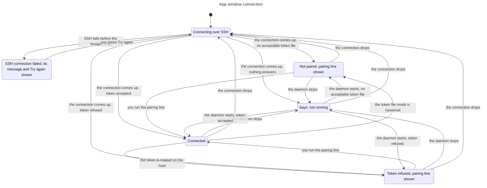
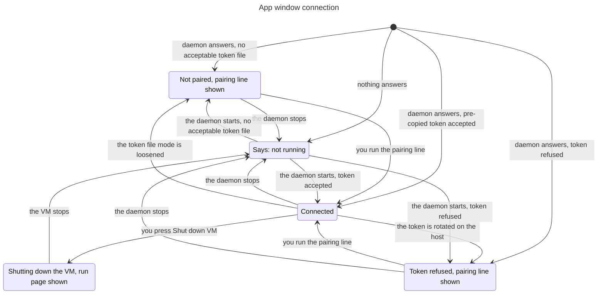

# App pairing and connection

Classification: Core. Prerequisites: [daemon](daemon.md),
[host](host.md), [ui-shell](ui-shell.md), [app build](app-build.md).

## Purpose

Connect the harness’s desktop app to the daemon in the host, with one owner token
copied once and sent to one address only. The page the app shows is
served by the daemon; the app is a window onto it and never starts, finds or
repairs anything on the host. This section owns the app's target, the pairing
line, token storage and rotation, the connection states, the lasting SSH
connection for hosts other than the supplied VM, request-origin guards,
opening host files in VS Code and how the app runs the host's Shutdown action.
[Ui-shell](ui-shell.md) owns the renderer boundary and path rules,
[settings](settings.md) the Shutdown VM page, [VM](vm.md) R9 the clean-stop
program.

## Required behaviour

- **R1 — Target.** The app's daemon address is `http://127.0.0.1:7797` and its
  token file is `~/Library/Application Support/myharness/owner-token`; the
  launch-time `MYHARNESS_API` and `MYHARNESS_TOKEN_FILE` override both
  ([verifiability](verifiability.md) R6). The paired origin is that address's
  scheme, host and port. The support folder name is fixed, so a changed display
  name never orphans the token. The app reads no daemon discovery file, no
  harness home and no other file on the Mac besides its support folder and its
  own bundle.
- **R2 — Pairing line.** Pairing is one command the person runs once in
  Terminal; the not-paired window shows it exactly, with the bot SSH name
  ([host](host.md) R3) filled in:
  `( umask 077; d="$HOME/Library/Application Support/myharness"; mkdir -p "$d" && ssh -n <bot name> cat .myharness/secrets/owner-token > "$d/owner-token.new" && mv "$d/owner-token.new" "$d/owner-token" || { rm -f "$d/owner-token.new"; exit 1; } )`.
  On first onboarding the setup agent prints this same line, with the bot SSH
  name filled in, before the app is opened. The person runs it in Terminal;
  a successful copy and an acceptable local token file (R3) pass onboarding
  `paired`. The app stays closed until `first-use`, when it is opened and
  verified `connected` ([onboarding](onboarding.md) R4, R9;
  [app build](app-build.md) R5). The not-paired window remains the recovery
  route for later missing or unacceptable tokens, not a required first screen.
  It runs in a subshell, so no umask stays behind; it moves the new file into
  place only after the copy succeeded, so a failed copy never empties a working
  token. It needs the host running with its daemon started once, which creates
  the token ([daemon](daemon.md) R4).
- **R3 — Token file.** The app accepts the file only when it is a regular file
  owned by the person, mode 0600, holding a token of the [daemon](daemon.md) R4
  format. It reads the file again for every request, so a new token is used
  without a restart. It never creates, repairs, rewrites or loosens the file; a
  wrong mode is reported with the exact `chmod 600` line to run.
- **R4 — Where the token goes.** The app's main process adds
  `Authorization: Bearer <token>` only to requests for the paired origin. The
  renderer never receives the token. Links, images, redirects and every other
  destination get no credential.
  A page or frame of another origin cannot obtain owner-authorized daemon
  access through the app, even when its request targets the paired daemon's
  origin. The mechanism is left open.

- **R5 — Connection states.** The window is always in exactly one of these
  states, or on an own host in a connection state of R7 (see below the list),
  and moves between them as named:
  1. `unreachable`: nothing answers at the address. The window says the
     harness is not running, offers no way to start anything, and tries again
     every 3 seconds; an answer moves it to `not-paired`, `refused` or
     `connected`.
  2. `not-paired`: the daemon answers, but the token file is missing or not
     acceptable (R3). The window shows the reason and the pairing line (R2).
     An acceptable file moves it on at the next try.
  3. `refused`: the daemon answers 401 to the token. The window says the token
     was refused and shows the pairing line. A new token moves it on.
  4. `connected`: the daemon answers with the token and the app page loads from
     the daemon. A lost connection moves it to `unreachable`; the conversation
     shown keeps [ui-shell](ui-shell.md) E1's offline state until the daemon
     answers again.

  On an own host requests reach the daemon only through the connection of R7,
  so `unreachable` applies only while that connection is `tunnel-up`. While it
  is `tunnel-starting`, `tunnel-down` or `tunnel-failed` the window shows that
  connection state and SSH's last message instead and never says the harness
  is not running.
- **R6 — Rotation.** Rotation is explicit: the token file is deleted on the
  host and the daemon restarted through the admin name, which makes a new token
  ([daemon](daemon.md) E1); the person then runs the pairing line again. The app
  moves from `refused` to `connected` at its next request.
- **R7 — Lasting connection for an own host.** For a host other than the
  supplied VM the app keeps one SSH connection running as its child:
  `ssh -N -o ExitOnForwardFailure=yes -o ServerAliveInterval=15 -o ServerAliveCountMax=3 -L 127.0.0.1:7797:127.0.0.1:7797 <bot name>`.
  Its states are `tunnel-starting`; `tunnel-up` (the forward is listening);
  `tunnel-down` (SSH exited after it was up: the app starts it again after 1
  second, doubling the wait to at most 30 seconds); and `tunnel-failed` (SSH
  exited before the forward came up, for example authentication, host key or a
  busy local port: the window shows SSH's message and retries only when the
  person presses Try again). While the connection is not up the window shows
  its state and SSH's last message in place of R5's `unreachable`. The local
  port is the same 7797; a busy port is a visible failure, never a silent
  change. The app stops its connection when it quits. The supplied VM uses
  Lima's forward ([VM](vm.md) R5) and no connection of the app's own.
- **R8 — Request-origin guards.** The window never leaves the paired origin:
  navigations, redirects and new windows elsewhere are refused, and web links
  open in the browser on an explicit click ([ui-shell](ui-shell.md) R6). Native
  operations answer only the top-level frame at the paired origin
  ([ui-shell](ui-shell.md) R7). The app has no file operations of its own on
  the Mac: recovery copies of unsent input and drafts go to the daemon
  ([turns](turns.md) R8), and there is no Finder reveal or directory picker.
- **R9 — Host files in VS Code.** A host file or folder opens in VS Code
  Remote-SSH through the bot SSH name. When no connected window exists the app
  opens `vscode://vscode-remote/ssh-remote+<bot name><absolute host path>`,
  with each path segment URL-encoded, and then waits as [ui-shell](ui-shell.md)
  R6 says. Nothing opens on the Mac itself.
- **R10 — The host Shutdown action.** On a press of Shut down VM
  ([settings](settings.md) R5) the main process runs the clean-stop program from
  its own bundle ([VM](vm.md) R9) with no argument, and with `--force` only for
  Stop anyway. Only the trusted sender of R8 may start it, one run at a time; a
  second press while it runs is refused. Output lines stream to the page as they
  arrive. Exit 0 with `result: stopped` or `result: already-stopped` is stopped
  or already stopped; exit 3 is the busy refusal listing the `busy:` lines;
  exit 1 is failed with the `reason:` text; exit 2 or a program that cannot be
  run is a failure that names itself, never success. A reconnect asked for
  during the run waits until the run ends, so the run's page stays in place.
  Besides `ssh` (R7) and this program, the app runs no program. For an own host
  the action is unavailable and the program is not run.

## States

On an own host (R5, R7):

On the supplied VM (R5, R10):

First onboarding copies the token before launch (R2), so a healthy supplied
VM opens directly connected. Not shown: pre-launch copying, the reconnect
timing of R7 and Shut down VM outcomes other than
stopped ([VM](vm.md) R9).

## Controls

These appear in the window's connection states, before any daemon page loads;
names are fixed by this spec.

| Role | Accessible name | Scope, action and observable state |
| --- | --- | --- |
| status | Connection | The window; names the R5 state and its reason, or, on an own host while the connection is not up, the R7 state and SSH's last message. |
| region | Pairing command | `not-paired` and `refused` states; the exact R2 line as text. |
| button | Copy pairing command | Pairing command region; copies the line and reports Copied. |
| button | Try again | `tunnel-failed` state only; starts the connection again. |

## Edge cases

- **E1 — Loose token file.** A token file with mode 0644 keeps the window in
  `not-paired` with the `chmod 600` line; the app sends nothing with it.
- **E2 — Another program on the port.** Whatever answers at the Mac's
  127.0.0.1:7797 receives the token, as any program running as the person
  could already read it from the support folder; the environment check reports
  a port held by anything other than the forwarder or the app (M-ports).
- **E3 — Daemon restarted with a new token.** The window moves to `refused`
  and shows the pairing line; it does not reuse or guess a token.
- **E4 — Tunnel up, daemon down.** With the SSH connection up but nothing
  answering on the host, the window is `unreachable`, not `tunnel-down`.
- **E5 — Shutdown run interrupted.** Quitting the app during a clean stop does
  not kill the program's `limactl stop`; the next launch finds the VM stopping
  or stopped and shows `unreachable`.

| Id | Given | When | Expect |
| --- | --- | --- | --- |
| **T1 — Main-process origin-bound credential** | Real isolated app, explicit daemon/token target and a dummy local token file | Request paired-origin page/fetch/event stream, request external destinations and replace the local token file | Main process adds the token only for the paired origin; renderer never receives it and other destinations receive none. Read the acceptable local file per request, so replacing it needs no app restart; host rotation still requires the person to pair again. Refuse foreign navigation and untrusted native senders (R1–R4, R6, R8; [ui shell](ui-shell.md) R7; [verifiability](verifiability.md) R6). |
| **T2 — SSH startup failure is not daemon absence** | Own host with SSH unavailable or authentication/host-key/forward failure before the tunnel is up | Start the app, observe failure and press Try again | Show the R7 connection state and SSH message, not not-running while the tunnel is down/starting/failed. Failure before forward-up is tunnel-failed with Try again, with no automatic retry until pressed. Keep fixed port/no silent substitute; supplied VM uses Lima forward, not this child (R5, R7, E4). |
| **T3 — Lost SSH connection reconnects** | Own-host app connected through its lasting SSH child | Drop that owned SSH connection, then permit reconnection | Show connection state/SSH last message rather than daemon-not-running while tunnel is not up. Retry after one second, doubling up to30; after forward and daemon/token succeed return connected. If tunnel is up but daemon absent, R5 unreachable applies (R5, R7, E4). |
| **T4 — Trusted, serial shutdown with live output** | Supplied-VM app with an owned stand-in bundled clean-stop program | Press Shut down VM/Stop anyway, attempt another run or request reconnect during it | Only trusted top-level paired-origin app sender may run it, one run at a time; untrusted/second requests run nothing. Plain action passes no force; --force only for explicit Stop anyway. Stream stdout/stderr lines as they arrive, and hold requested reconnect until settlement so output page stays in place, then honor the request. Own host has no action/program run (R8, R10; [settings](settings.md) R5; [ui shell](ui-shell.md) R7). |
| **T5 — Stop results remain distinct** | Bundled program emits documented result/busy/reason lines or cannot run | Complete each exit path and observe the Shutdown VM page | Exit0 with result stopped/already-stopped maps distinctly; exit3 is busy refusal with reported busy lines, never success even if its list is empty. Exit1 retains reason; exit2 or missing/nonexecutable/spawn failure is a named failure, not stopped. Do not infer success from streamed prose alone (R10; [VM](vm.md) R9; [settings](settings.md) R5, E3). |
| **T6 — Foreign initiator gets no owner authority** | Foreign-origin page/frame and an isolated app paired to a dummy daemon; legitimate paired-app positive control | Make HTTP requests through the app to the paired daemon target | The foreign-origin page/frame cannot obtain owner-authorized daemon access even though destination is paired. Preserve legitimate paired-app access, existing credential secrecy and native-sender/navigation rules; no initiator mechanism, header, status code or new endpoint is prescribed (R4, R8). |
