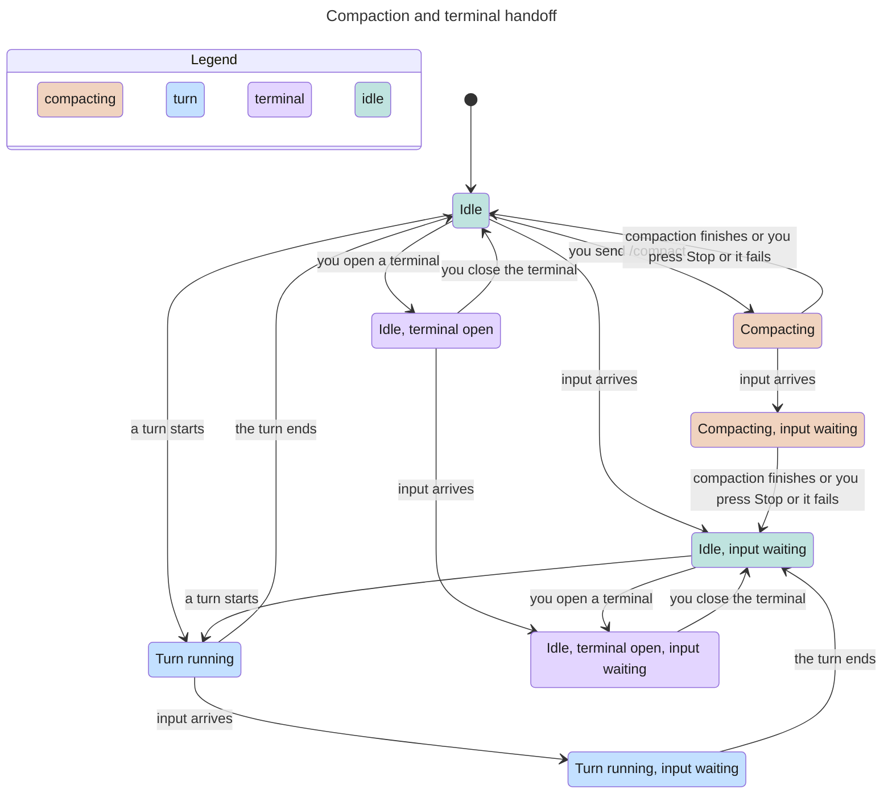

# On-demand compaction

Classification: Core. Prerequisites: an existing compatible session and selected engine;
[turns](turns.md).

## Purpose

Let the person shorten model context without pretending to delete the visible
conversation. Native summaries and command records remain inspectable, with
honest token-count provenance and explicit missing-history limits.

## Required behaviour

- **R1 — Person command only.** A person's text is a compaction request when,
  after leading whitespace is removed, it is `/compact` followed by whitespace
  or end of text. Trim the remainder, including multiline instructions, and
  send it only to the engine's summarizer. Do not store it as an ordinary person
  message or create a new session merely to compact. `/compactness`, mid-text
  mentions and sender-framed bot/routine/incident inputs are ordinary text.
  Entry points are the normal composer, `myharness say <bot> ...`, and owner
  `POST /sessions/<bot>/<sid>/say` with `text`; `latest` resolves an existing
  nonarchived session. Success returns `session` and `compact` with `ok`, and
  `before`, `after`, `afterSource` when reported.
- **R2 — Idle boundary.** Reject with 409 if the session is running, starting,
  compacting, launch-locked, terminal-owned, or has pending/dispatching input
  or active queued work. With no reusable live process and no available process
  slot, refuse rather than exceed `max_processes`. A retired or incompatible
  session is read-only: direct the person to its continuation. A nonexistent
  target or an engine refusal for too-small context is not a successful no-op.
- **R3 — No composite draft.** Reject images or annotations, including serialized
  annotation blocks, with 400 and keep the draft. `/compact` cannot be saved,
  promoted or dispatched as a follow-up queue card. It never becomes queued
  ordinary input. During compaction show busy/compacting state; Stop cancels the
  operation through the native engine. Finish clears the transient state and
  allows normal pending-work processing. Errors remain visible; a failed or
  interrupted request does not claim that context was shortened.
- **R4 — Native operation.** Pi uses native RPC compaction with custom
  instructions, preserving native summary wrapping and kept-entry boundary;
  record instructions/trigger when available and label its after-count a Pi
  estimate. Claude Code uses its native `/compact` operation and confirms a
  native compact boundary rather than inferring success from arbitrary reply
  text. Preserve its summary and native local-command records in native order;
  counts/duration come from native reports. Missing values read as not reported
  or not recorded, never zero or invented instructions. The system prompt is
  unchanged by compaction.
- **R5 — Transcript presentation.** Render each native compact boundary as a
  folded `Context compacted` record, separate from person/assistant messages.
  Its expanded text identifies engine/version if known, instructions, trigger,
  before/after counts with sources, duration when native Claude reports it,
  full summary as the model reads it, and native command records when present.
  Missing summary data is visibly not recorded. Earlier readable messages stay
  available; place a divider for history no longer in context. For Pi show
  `Kept in context` at the beginning of the kept turn, not just an arbitrary
  tool entry. For Claude mark missing earlier native history and do not imply
  old tool results necessarily remain in model context. A later summary covers
  earlier summaries. Search matches inside a folded record expand it while the
  match is active; clearing search restores the person's fold state.

## States

One session, a compaction and a terminal handoff. Compaction is refused while a
turn runs, input waits or a terminal holds the session (R2); opening a terminal
is refused while a turn runs or a compaction is in progress
([terminal chat](terminal-chat.md) R2).

## Controls

The composer, Send and Stop are owned by [turns](turns.md); [search](search.md)
section owns query controls. Repeated records are scoped by their visible
session and transcript entry in regions named `Context compacted <entry>`.

| Role | Accessible name | Scope, action and observable state |
| --- | --- | --- |
| button | Context compacted | Within its record region; expands/folds full text with expanded state. Search-owned expansion is aria-disabled and cannot fold until the matching query clears. |

## Edge cases

- **E1 — Failure or interruption.** Keep refused composer content; distinguish
  busy/invalid draft from native failure and unknown completion. Reload native
  transcript before intentionally retrying an unknown result. Do not guarantee
  byte-for-byte rollback of a native operation that may already have completed.
- **E2 — Absent historical data.** A record without captured instructions does
  not mean no instructions were given. Missing pre-compaction history is
  disclosed and is not recreated from a summary. Fork limitations belong to
  [conversation branching](conversation-branching.md).
- **E3 — Race with arrival.** Work arriving after compaction starts waits behind
  it; do not mix it into the summarizer's instructions or report it picked up
  merely because compaction completed. R2 applies when admitting the request.

| Id | Given | When | Expect |
| --- | --- | --- | --- |
| **T1 — Refused control keeps the draft** | Existing session; a person requests compact with a composite draft, active work or a queue edit | Send or try to save/promote a compact command as follow-up | Apply R1 parsing and R2 admission: busy/ownership/input/slot conflicts refuse; images/annotations reject with 400. No queued ordinary compact input or new session; keep refused draft and the original queued text (R1–R3, E1). |
| **T2 — Stop, unknown completion and arriving work** | Native compaction runs; another input arrives | Stop or lose native completion, then inspect/reload | Show compacting, clear transient state on finish, and process later work only under normal pause/ownership rules. Do not mix arriving text into summary instructions or claim its pickup from compact completion. Unknown completion needs native reload before intentional retry, not automatic resubmission or promised byte rollback (R3, E1, E3; [turns](turns.md) R4). |
| **T3 — Native compact record after a fork** | A Claude branch has a native compact boundary, summary and command records | Continue the branch and reload its transcript | Present one compact record for the native boundary in native order, with the full native summary and command records, not fabricated ordinary person/assistant text (R4, R5; [engine-claude-code](engine-claude-code.md) R6). |
| **T4 — Folded proof and count provenance** | Native compact records from selected engines, including absent fields/history | Expand/fold and search inside a record | Show Context compacted separately, full summary/known engine/version/instructions/trigger and count sources. Pi after-count is estimated; missing data is not reported/recorded, not zero or invented. Keep earlier readable messages and disclose missing history. Search owns matching expansion and restores the person's fold state on clear (R4, R5, E2, Controls). |

Proof: While a compaction is held, `suite/compaction.mjs` reads a 409 from the terminal handoff and exit 1 from terminal chat on that session, then reads that the compaction finishes ok. Evidence: JSON.