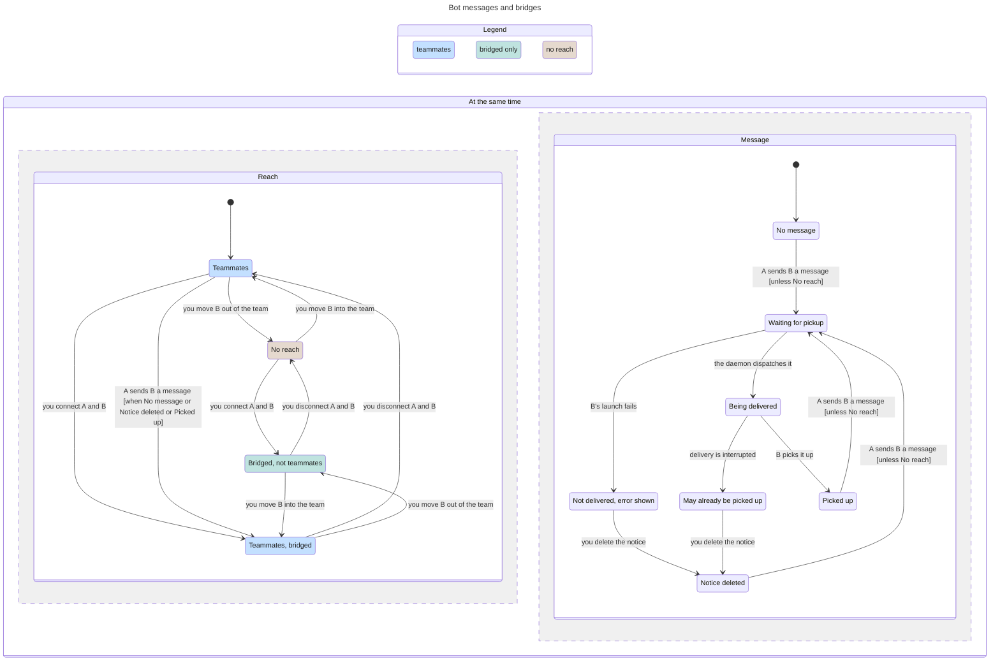

# Explicit bot messages and bridge threads

Classification: Core. Prerequisites: two configured bots, daemon, and live sender session credential.

## Purpose

Let a bot explicitly send work or a reply to a reachable peer without
cross-wiring conversations. No ordinary assistant completion is automatically
forwarded as a bot reply. [Teams](teams.md) determines implicit reach;
[daemon](daemon.md) separates owner and session authority.

## Required behaviour

- **R1 — Sender and request.** Bot-session-authenticated `POST /messages`
  accepts `{to, text, session?, new_session?}`. Derive sender bot/session only
  from the credential; body fields cannot impersonate another sender. Require
  nonblank text; self-send is 400, unreachable/unknown recipient is 403 with
  permitted recipients. `GET /reachable` returns sorted distinct reachable ids.
  The engine-facing `send_message` offers this same operation asynchronously:
  a delivery acknowledgement is not a reply or proof of a successful turn.
- **R2 — Routing.** `new_session` creates a recipient session with that title,
  origin bot and `reply_to` the sender session. It takes precedence if both
  selectors are supplied. Explicit `session` resolves using sessions' rules
  and is allowed only if the recipient session has replied to this sender bot
  or has a recorded message exchange with it (including continuation lineage).
  It is not permission to browse or message any private session of a peer.
- **R3 — Unaddressed continuation.** With neither selector, first follow reply
  ancestry toward the requested peer, bounded to eight hops with cycle checks,
  following live continuation lineage and requiring an unarchived target.
  Otherwise choose the one unarchived, non-retired recipient session answering
  this sender lineage. None or more than one returns 409, sends nothing, and
  asks for `new_session` or an explicit `session`. Never pick the peer's newest
  unrelated conversation. A successful response identifies session id/title.
- **R4 — Bridges.** Effective reach is led-team reach plus explicit bridge peers.
  A first allowed message creates a bridge if absent, attributed to its sender;
  it cannot create permission to reach an otherwise unreachable bot. This holds
  between led teammates too: their first message creates a bridge, which keeps
  the two bots in reach after either leaves the team until the person
  disconnects it in Bot threads. Owner
  `POST /bridges` with `{a,b,note?}` connects two different existing bots,
  including unteamed/leadless bots; repeated connect preserves creation/origin
  and changes only a supplied changed note. DELETE `/bridges/<a>/<b>` removes
  the link, not the message log. CLI `connect`, `disconnect`, `bridges [bot]`
  expose this contract, including unchanged/empty results.
- **R5 — Durable exchange.** Pair ids are sorted in `bridges/<a>--<b>/`.
  `link.toml` records `created`, `by`, `kind` (`user` or `first-message`) and
  `note`. `log.jsonl` contains messages with `m_<UUID>` id, timestamp, sender
  and recipient `{bot,session}`, `kind: message`, framed text, delivery time
  and optional error. Delivery updates merge by message id. Frame input as
  `[from <bot-id> · <JSON-quoted sender-session-title>]` then newline and body;
  the model sees it as another bot, not the person. Only an explicit message
  makes an entry: the end of a turn, an abort or an error never does.
- **R6 — Pickup and failure.** Accept bot inputs durably in the recipient's
  incoming queue before native dispatch, deduplicating the bridge id across
  continuation lineage. Owner session detail lists that queue as `incoming`,
  each item with at least `id`, `state` (`pending`, `dispatching`,
  `picked_up` or `delivery_unknown`) and, when one was recorded, `error`; a
  message whose dispatch failed before it was sent stays `pending` with its
  `error`. While running, incoming messages can be batched for
  steering, retaining each id/text; this queue is separate from the person's
  three-item follow-up limit. Native pickup/transcript receipts confirm model
  input pickup; a bridge log delivery timestamp instead records the dispatch
  attempt's acknowledgement (and can accompany an error). Definitely unsent
  messages remain pending; dispatch interrupted
  without confirmation becomes `delivery_unknown` and is not replayed
  automatically. Restart can recover confirmation from receipts. A failed
  recipient launch yields 502 with explicit unsent-versus-uncertain guidance
  and a failure alert where appropriate, not a successful-send claim.
  Messages to a busy bot are delivered in arrival order.
- **R7 — Inspection and cancellation.** Owner GET `/bridges` lists current
  links and last-message summaries; GET `/bridges/<a>/<b>` returns link/null
  and recent merged log (up to 500 messages by default). The Bot threads view
  has one row and one combined conversation per bridge, showing both directions,
  sender, time, delivery state and note/origin. It updates on new messages.
  Owner POST `/sessions/<bot>/<sid>/incoming/<id>/dismiss` can cancel an unknown
  pickup or an errored pending message, recording person/time/prior state;
  it cannot erase a picked-up message. Intentional resend uses a new id.
- **R8 — Terminal recipient.** A Pi-attached session receives bot messages
  through its authenticated mailbox rather than concurrent daemon steering.
  A Claude-owned session keeps incoming work durably queued until ownership
  ends, with no terminal injection. [Terminal chat](terminal-chat.md) owns
  handoff, ownership and release; closing an app does not remove a bot's
  messaging address.

## States

Bots A and B and one message at a time from A to B; the two parts change
together where an arrow says so. A first message between teammates creates a
bridge (R4), so moving B out of the team leaves them bridged until you
disconnect them.

## Controls

The [Tools](tools.md)/[shell](ui-shell.md) sections own entering/leaving Bot threads. Repeated
bridge rows are named by sorted bot ids, not potentially duplicate display names.
Control names below are fixed by this spec.

| Role | Accessible name | Scope, action and observable state |
| --- | --- | --- |
| button | Connect two bots | Bot threads page, including empty state; opens dialog. |
| button | Thread <a> and <b> | One bridge row; opens its combined conversation. |
| dialog | Connect two bots | Has bot ids, optional note, validation errors. |
| textbox | First bot id | Dialog; existing id required. |
| textbox | Second bot id | Dialog; different existing id required. |
| textbox | Why | Dialog; optional note stored in link.toml. |
| button | OK | Dialog; attempts connect, shows failure without false completion. |
| button | Cancel | Dialog; closes without change. |
| button | Bridge actions | Bridge conversation; opens menu. |
| menu | Bridge actions | Dismissible by outside click or Escape without change. |
| menuitem | Open bot <id> | One per endpoint; navigates to that bot. |
| menuitem | Disconnect | Opens disconnect confirmation. |
| dialog | Disconnect bots | Warns the log stays and team reach may remain. |
| button | Disconnect | Confirmation; removes link and returns to list. |
| button | Cancel | Confirmation; no change. |
| button | Delete notice | Conversation's `Bot input notice <id>` region; cancels eligible incoming notice, not transcript text. |

No connections and no messages are explicit empty states. A disconnected detail
can still show the retained log plus “not connected”; it is not an active link.

## Edge cases

- **E1 — Race or ambiguity.** Unreachable or ambiguous sends do not create an
  arbitrary recipient session. Permission is checked at send time. An already
  delivered message is not recalled by subsequent disconnect.
- **E2 — Acknowledgement boundary.** Stored/delivery timestamps are not proof
  the recipient model completed successfully. Preserve delivery errors in the
  log and warn before intentional resend of uncertain pickup.
- **E3 — Disconnected links.** Disconnect keeps the link's log on disk, and
  local history records the link removal. There is no automatic introduction
  or forwarding between bots.
- **E4 — Effects before the screen.** A case checks routing, the bridge log
  and delivery state through the API and files first, and the Bot threads
  screen by role and accessible name second.

| Id | Given | When | Expect |
| --- | --- | --- | --- |
| **T1 — Busy recipient input** | A busy recipient bot and distinct incoming messages | Messages arrive while a turn runs, including batched steering | Deliver in arrival order, retaining each id/text and sender frame. Confirm pickup by native receipts, not a bridge timestamp; uncertain dispatch is not auto-replayed (R5, R6; [turns](turns.md) R5). |
| **T2 — Errored pending notice** | A recipient's definitely-unsent message is pending with an error | Read status, mark idle when no other work prevents it, then dismiss the notice | Keep input/error without replay; errored input alone is not working or a reason to refuse the idle mark. Eligible cancellation records person/time/prior state without resending; picked-up input cannot be erased (R6, R7; [status](status.md) R1, R3). |
| **T3 — Connect again** | Existing explicit bridge | Repeat connect, with no note or an explicitly changed note | Retain creation/origin metadata; only a supplied changed note changes. Connecting does not itself send a message (R4, R5, E3). |
| **T4 — No selector is not newest-session routing** | Reply ancestry, or zero/one/several unarchived, non-retired recipient sessions answering the sender lineage | Send without session or new_session | Walk live reply ancestry for at most eight hops with cycle checks; otherwise use only the unique eligible answerer. None/multiple means 409 and nothing sent, asking for a selector; never choose an unrelated newest session (R3, E1). |
| **T5 — Live or missing continuation** | A reply route follows continuation lineage, or the continuation target is missing | Resolve the old address | Follow live lineage; a missing continuation leaves the old session readable but never silently resumes it on an incompatible engine. In the old session view, state the target is gone and offer New session; do not loop through broken chains (R3; [sessions](sessions.md) R6, E3). |
| **T6 — Reply address across continuation** | A recipient session exchanged messages with the sender, including a person-created fork | Reply explicitly after compatible continuation lineage changes or after the old process exits and the configured engine changes | Existing exchange permits that reply target; engine changes use a new UUID preserving title/reply address, not incompatible native resume (R2; [sessions](sessions.md) R6). |

Proof: `suite/messaging.mjs` checks: a first message between led teammates creates a bridge that Bot threads lists and that survives the member leaving the team; disconnecting removes `link.toml`, keeps `log.jsonl` and ends the reach; a turn ending in plain text, a model error or an abort sends nothing back and adds no log entry; a message to a recipient that cannot start stays pending with its error, tells the sender, and is delivered once at the next start after the fix. Evidence: JSON.