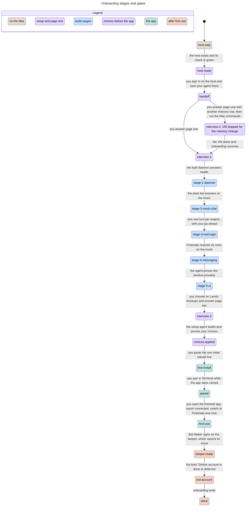

# Onboarding and the interview

Classification: Core. Prerequisites: [host](host.md),
[VM](vm.md) when chosen, the selected engine adapters,
[starter bots](starter-bots.md).

## Purpose

Take a person from a repository link to a harness they trust, in an order that
builds and proves it in small stages, then shows the person the finished app
with their choices applied before handing coordination to its crew. The person
gives the repository to their own agent and says they want their own harness;
the agent interviews them and builds it. This section owns the
questions asked before anything is installed, the interview pages, their order
and defaults, the stages and their gates, the interview record, the display
name and the plain bot's name. Each choice section owns its own question and
default; [host](host.md) and [VM](vm.md) own what the host step installs;
[app build](app-build.md) and [app pairing](app-pairing.md) own the app steps.

## Required behaviour

- **R1 — Before anything is installed.** The person's agent on the Mac first
  states, in a few lines, what the harness needs: an Apple Silicon Mac,
  isolation from the computer the person works on, and for the supplied VM its
  memory row for this Mac and a disk file that grows to at most 100 GiB
  ([VM](vm.md) R3). It then asks, in chat, the host-step questions:
  1. `power`: how the bots will be powered: Claude models through Claude Code
     on the person's own login, OpenAI models through Pi signed in with
     ChatGPT, or an API key for a named provider through Pi; one or more. The
     default is both engines: Claude Code for Anthropic models on the person's
     own Claude login and Pi for OpenAI models signed in with ChatGPT, so the
     person can use either family. BYOH still gives no advice between a
     subscription and an API key: either route can be replaced by an
     API key for a named provider through Pi. The answer selects the adapter
     sections ([engine contract](engine-contract.md)) and the terms wording
     their sections own.
  2. `host`: the supplied VM (default) or a Linux machine of the person's own,
     given by its two SSH names ([host](host.md) R3).
  3. `disk_layout` (supplied VM only): one disk (default) or a separate data
     disk, asked only after the trade-off in [VM](vm.md) R4 is explained,
     because the layout is fixed at creation.
  4. `prevent_sleep` (supplied VM only): macOS's prevent-sleep setting on the
     power adapter, pre-selected ([VM](vm.md) R8).

  For the supplied VM the host step also writes the SSH names file and its one
  `Include` line ([VM](vm.md) R5).

  Before page one the record (R5) holds these answers and both SSH names, and
  no credential travels with them; how they reach the host is the person's
  agent's choice.

  Every question shows its default and "go with the defaults" answers all four
  at once. Nothing from the repository runs on the Mac
  except the pinned host step ([VM](vm.md) R2).
- **R2 — Handoff.** When the environment check is green ([host](host.md) R10),
  the agent prints the command that opens a terminal on the host as the bot
  user (`ssh myharness` for the supplied VM, otherwise the bot SSH name). The
  person signs in there with each engine they chose, using its own sign-in
  ([engine Pi](engine-pi.md), [engine Claude Code](engine-claude-code.md)), and
  starts their agent there with the repository at its pinned tag.
  The pinned tag is the release named in the top-level README. From then on
  the interview, the build and the first chat happen in the host. Before building,
  that agent reads the pinned blueprint's [verification skill](../verify/SKILL.md)
  and uses its isolated kit/evidence workflow at the build stages. The suite
  remains the only pass/fail gate; this adds no stage or real-login permission.
- **R3 — Interview pages.** The interview runs on Lavish pages served from the
  host, through `npx -y lavish-axi@<pinned version>` with its usage data turned
  off, on port 4388, so the page opens in the Mac
  browser at `http://127.0.0.1:4388/...`. For an own host the agent first gives
  the person a one-time forward for that port (`ssh -N -L
  127.0.0.1:4388:127.0.0.1:4388 <bot name>`). A page asks four or five
  questions, each with its default visible and a "Go with the defaults" action
  for the whole page. There are two pages:
  1. Page one, before the first chat: `display_name`, `plain_name` (R6),
     `model`, asked as "Which model should Firstmate run on?", and for the
     supplied VM `vm_memory`, the [VM](vm.md) R3 table with this Mac's row
     selected. Choosing another row gives the person the exact Mac commands to
     run (stop, edit memory, start), because that change happens on the Mac.
     The agent first records page one (R5, `progress` `interview-1`) and only
     then shows those commands, saying that after the restart the person starts
     the agent again in the host and onboarding resumes (R8).
  2. Page two, after the agent proves the UI but before the person sees their
     app (R4): the release-one choices
     in this order, each worded and defaulted by its own section:
     [look and palette](look-and-palette.md), [window behaviour](window-behaviour.md),
     [desktop notifications](desktop-notifications.md),
     [conversation export](conversation-export.md) and [VM backup](vm-backup.md),
     with their follow-up questions. Only choice features the release ships are
     offered; keyboard shortcuts and the phone companion are
     not.

  The `model` question says that every starter bot gets the same model and any
  bot can be changed later in the [model picker](model-picker.md). The default
  leaves their model unset, so [engine contract](engine-contract.md) R1 decides:
  with both engines, Pi's default on the chosen route. The agent reads the
  selected engines at run time and names the concrete model that default
  resolves to; no model name is fixed here. BYOH suggests an intelligent
  frontier model that communicates well, because Firstmate and Bot Maker give
  the most leverage and extra intelligence there pays off most. Do not present
  a full model list. If the person's named model maps to exactly one model on
  their selected engines, use it; if ambiguous, show only the candidates the
  agent cannot tell apart and ask the person to pick.

  Page two's look question uses the fixed shell mockups and iteration in
  [look and palette](look-and-palette.md) R1, never pictures of the person's app.
  The other four choices remain plain questions on that same page. Both pages
  have the R10 progress line as their header.

  If the page cannot be served, the agent asks the same questions in chat with
  the same defaults and records the answers the same way. For the look, the
  person may explicitly accept the default-look option named Instrument only
  alongside a visual of its fixed mockup. If no such visual can be presented,
  or the person wants a custom look, look selection waits until Lavish works;
  chat fallback never substitutes actual-app screenshots.
- **R4 — Stages and gates.** Onboarding moves through these states in order;
  each state is entered only when the previous one's proof passes, and a
  failure stays in its state with what failed named:
  1. `host-step`: R1 answered.
  2. `host-ready`: the host exists and the environment check is green.
  3. `handoff`: R2 done; the agent runs in the host.
  4. `interview-1`: page one answered.
  5. `stage-1-daemon`: the built daemon starts on an isolated instance and
     answers health ([verifiability](verifiability.md)).
  6. `stage-2-mock-chat`: the plain bot answers through each selected adapter
     against the mock model ([starter bots](starter-bots.md) R6).
  7. `stage-3-real-login`: one real turn per selected engine on the person's
     own login, with the person's go-ahead; from here the environment check treats logins as
     required.
  8. `stage-4-messaging`: Firstmate reaches its two crew members and receives
     their replies on the mock model.
  9. `stage-5-ui`: the real app runs on the host's virtual display. Its
     screenshots and other UI evidence are the agent's own proof, not shown to
     the person, including on a failure.
  10. `interview-2`: page two answered, including an accepted look from Lavish
      mockups or explicit acceptance of the pictured default-look option (R3).
  11. `choices-applied`: the setup agent builds the page-two choices into
      `~/myharness-src` and proves the resulting build with the suite. The
      person's app is still not shown to them.
  12. `first-install`: the person pastes the rebuild line ([app build](app-build.md)
      R2); the live daemon runs and the finished app, with choices applied, is
      in `~/Applications`. This is the one initial installation, not an
      installation of defaults followed by another for choices. On this first
      onboarding the line omits the final app-open step; the app stays closed
      until pairing is complete and `first-use` begins (app build R5).
  13. `paired`: the setup agent prints the unchanged pairing line ([app
      pairing](app-pairing.md) R2), with the bot SSH name filled in, and the
      person runs it in Terminal while the app stays closed. The copy succeeds
      and the local token file meets app pairing R3; no token enters the record
      or evidence. Connection is verified when the app opens in `first-use`.
  14. `first-use`: the setup agent tells the person to open the installed app
      after pairing and confirm that it is `connected`; the person opens it
      and reports that confirmation. The person's first window is the finished app with their choices applied.
      They switch to Firstmate under R9, chat and
      see work done. Present the choices' Mac checks here; what the host cannot
      prove stays `mac-pending` until answered.
  15. `keeper-ready`: Firstmate's first job after the switch is to task Bot
      Maker to sign on a harness keeper for `~/myharness-src` from the crewmate
      template. Show the person the brief, overlap check, files and live check
      as they happen. The keeper owns the source from then on and completes
      its small first task: a read-only scout/handover audit of the record and
      source, identifying source/build/test entry points and chosen features,
      running existing safe local checks and reporting the source map plus
      one next-maintenance recommendation to Firstmate. No edits, pull request,
      installation, real-login turn or deploy belongs to this task
      ([starter bots](starter-bots.md) R7).
  16. `bot-account`: the bots' own GitHub account (R7), done or deferred.
  17. `done`.
- **R5 — The interview record.** Answers live in `interview.json` at the root of
  the harness source repository ([app build](app-build.md) R1) and are
  committed with it, so every build uses the answers of its own commit. It is
  UTF-8 JSON, written whole through a temporary file and a rename:
  `{"schema": 1, "progress": "<R4 state>", "answers": {"<id>": <value>},
  "defaulted": ["<id>", ...]}`, where `progress` is the last state passed and
  `defaulted` lists answers taken by default. The ids are those in R1 and R3
  and the ids the choice sections give their questions; the bot and admin SSH
  names are recorded under `host`. The host-step answers and both SSH names
  are in the record before page one (R1). The record holds no credential,
  token or key. Settings that a section stores elsewhere stay there (for
  example `notify` in `myharness.toml`).
- **R6 — Names.** `display_name` is the name the person gives their harness,
  shown throughout the app and in the app's bundle name, never a command or
  path; its default is `My Harness`. `plain_name` is the display name
  of the plain bot, whose id stays `plain`; its default is `plain` ([starter bots](starter-bots.md) R1). Both are accepted when, after trimming
  leading and trailing white space, they hold 1 to 64 characters with no
  control character or line break. An invalid value keeps the page open with
  the reason beside the field and every other answer kept; nothing is written
  until the page is valid. The plain name is written as the plain bot's
  `bot.toml` `name`, escaped as a TOML string. A later change of the display
  name is a record change and a rebuild; a later change of the plain name is an
  ordinary bot edit ([config editors](config-editors.md)).
- **R7 — The bots' own GitHub account.** The agent offers to guide the person
  through creating the bots' account: one machine account the person is
  responsible for, using their inbox through a plus address, two-factor
  authentication with an authenticator app, fine-grained tokens scoped to the
  person's chosen repositories, and a profile saying it is an automation account
  they operate; the token is entered on the host with the GitHub CLI as the bot
  user. The default is to do it later, when a bot first needs GitHub; the agent
  says how to ask for it then.
- **R8 — Resuming.** Running onboarding again with an existing record offers
  the recorded answers as the defaults, starts at the first state after
  `progress`, and never resets a home or renames a bot
  ([starter bots](starter-bots.md) E1).

- **R9 — Switch to the harness.** At entry to `first-use` the live daemon is
  running, the app is installed and paired, and the suite is green on that
  build. Only now, after the pairing line has succeeded, the setup agent tells
  the person to open the installed app on the Mac and confirm `connected`.
  The person opens it and reports that confirmation before the switch; the
  setup agent running in the host does not claim to open the desktop app on the Mac itself. A failure
  names the failed proof and does not advance recorded progress. The setup
  agent plainly says it is time to switch from that agent to
  the person's own harness. It prints a complete first message for
  the person to paste to Firstmate in the app, with no unfilled placeholders:
  ask Firstmate to read `~/myharness-src/interview.json`, establish the recorded
  answers and progress, and lead the remaining onboarding from there. The
  message also names the absolute path of the blueprint folder. Firstmate
  writes that path as one MEMORY.md line the first time it reads it, so a
  later R8 resume can find the spec without a new interview field. Both SSH
  names are read from `host` in the interview record, not installed into the
  charter. This is a person message, not a new command or daemon endpoint.
  Read Firstmate's
  address from the [starter table](starter-bots.md) R1.
  The setup agent gives concrete instructions for returning to that existing
  agent on the host; it stays installed. The earlier R2 Mac-to-host handoff is
  not this later switch of coordination point.

  Firstmate uses its seeded resume skill ([starter bots](starter-bots.md) R7)
  to read R5's record rather than ask the person to repeat completed questions
  or pretend its minimal charter contains the answers. Its first reply proves
  that context by identifying actual recorded answers, the last passed state
  and the next unpassed state, opening with the R10 progress line and plain
  what/why narration. First-use work and the remaining gates still
  need their R4 proof; neither a greeting nor the switch alone advances them.
  From this switch onward, the agent in R7 and R8 is Firstmate inside the
  harness. Page two and its choice build are already complete. Firstmate's
  first job is the `keeper-ready` sign-on and scout task (R4); it then leads
  the bots' GitHub account. Firstmate narrates each step under R10. The sign-on
  brief includes the absolute blueprint path and its `verify/SKILL.md`. The
  keeper records that skill path in its project context and uses it for later
  harness changes without a duplicate skill installation or a new gate.
  Resume remains R8's first state after recorded progress; no new interview
  field, reset, privilege or automatic deploy is introduced.

- **R10 — Explain the journey.** From R1 on the Mac through `done`, the setup
  agent, then Firstmate after R9, treats the person as an intern on their first
  day, with no assumed knowledge of BYOH. Every step message opens with the
  plain-text progress line below, followed by one or two plain lines saying
  what is happening now and why it matters to the person. Use it in chat and
  as the header on both Lavish pages, including during look iterations and on
  failure/resume messages. Firstmate's first reply after the switch also opens
  this way ([starter bots](starter-bots.md) R7).

  For example, after `stage-3-real-login` has passed:
  `▓▓▓▓▓▓▓░░░░░░░░░░ 41% · step 7 of 17 · now: checking the crew can talk · next: proving the window`.
  The number of completed steps is the one-based index of the last passed R4
  state, taken from the existing record's `progress`; percent is that index
  divided by 17, times 100, rounded to the nearest integer. Use 17 character
  cells, one filled per passed state. Before `host-step` passes there is no
  passed state: show 0%, step 0 of 17, and empty cells, without creating a new
  record state. At `done` show 100%, step 17 of 17, all cells filled, and
  `now: setup complete · next: use your harness`. Otherwise `now` names the
  next unpassed state in plain words and `next` the one after it. While working
  on `done`, use `next: use your harness`. A failed proof or interrupted stage
  does not advance the bar. Derive it again on resume; add no field, counter or
  separate progress store to the interview record.

  Introduce each glossary component at its listed R4 state, using its
  one-sentence explanation at first mention. Do not re-explain it later.
  On resume or after the R9 switch, a term whose introduction state has passed
  according to the record's `progress` counts as already explained; derive
  that set from this table, not from shared conversation context or a new
  record field. Re-explaining a term once after an interruption within its own
  introduction state is acceptable. Whenever the default-look option named
  Instrument is offered, name it as an option and show its mockup visual
  alongside it; do not assume the person knows that name.

  | Component | Introduction state | First-mention explanation |
  | --- | --- | --- |
  | BYOH | `host-step` | BYOH is the blueprint your agent uses to build and check your own bot workspace. |
  | Harness | `host-step` | Your harness is the workspace where you talk to bots and see the work they do. |
  | Setup agent | `host-step` | Your setup agent is the coding assistant building your harness before its own crew takes over. |
  | Lima | `host-step` | Lima runs the separate Linux computer inside your Mac so the bots do not work in your personal files. |
  | VM | `host-step` | A virtual machine, or VM, is that separate computer inside your Mac, keeping the bots' workspace apart from yours. |
  | Host | `host-step` | The host is the Linux computer running your bots, either our VM or a separate machine you provide. |
  | SSH | `host-step` | SSH is the secure connection your Mac uses to reach that host without exposing the harness to the network. |
  | Daemon | `stage-1-daemon` | The daemon is the background program that keeps your bots, conversations and messages running on the host. |
  | App | `stage-5-ui` | The desktop app is your window into the harness, connecting your Mac to the daemon on the host. |
  | Engine | `host-step` | An engine is the program that connects a bot to its chosen AI model. |
  | Model | `host-step` | A model is the AI doing a bot's thinking and writing, which you can change for each bot later. |
  | Pi | `host-step` | Pi is an engine that connects your bots to OpenAI models or a provider you choose with an API key. |
  | Claude Code | `host-step` | Claude Code is the official engine connecting your bots to Claude on your own login. |
  | Mock model | `stage-2-mock-chat` | The mock model gives scripted replies for safe repeatable checks, without using your real AI account. |
  | Lavish | `interview-1` | Lavish shows the interview as pages in your browser so you can choose comfortably. |
  | Firstmate | `interview-1` | Firstmate is the bot you talk to for coordinating work and getting the right bot to do it. |
  | Bot Maker | `interview-1` | Bot Maker creates and maintains bots so you can add a helper without wiring it up yourself. |
  | Code Reviewer | `stage-4-messaging` | Code Reviewer checks proposed source changes for defects before you decide whether to accept them. |
  | Plain bot | `interview-1` | Your plain bot answers quick questions and searches the web without managing projects or tasks. |
  | Harness keeper | `keeper-ready` | Your harness keeper will be the bot that owns your harness source and handles its future maintenance. |
  | Interview record | `host-step` | The interview record saves your choices and completed steps so setup can resume without asking everything again. |
  | Suite | `handoff` | The conformance suite is the set of checks that decides whether your built harness meets the blueprint. |
  | Verification kit | `handoff` | The verification kit gathers screenshots and other evidence from a separate test instance so your agent can inspect its work. |
  | Virtual display | `stage-5-ui` | The virtual display lets your agent run and inspect the app on the host without showing you an unfinished window. |
  | Palette | `interview-2` | A palette is the set of colours used throughout the app, letting you choose its look without changing how it works. |
  | Instrument option | `interview-2` | Instrument is the name of this pictured default-look option, which you can keep or use as a starting point. |
  | Mockup | `interview-2` | A mockup is a fixed example of the app shell used to compare colours, not a picture of your own unfinished app. |
  | Pairing | `paired` | Pairing gives the desktop app the owner token it needs to access your daemon without exposing it to other pages. |
  | Owner token | `paired` | The owner token is the secret your app uses to prove it may access the daemon, so it is never put in your interview record. |
  | GitHub | `bot-account` | GitHub stores source and proposed changes, and a separate bot account lets you grant and revoke the bots' access independently of your own. |
  | Pull request | `keeper-ready` | A pull request presents a proposed source change for review before you approve merging it. |
  | Rebuild line | `first-install` | The rebuild line is the command you choose to run to build and install an approved version of your harness. |

## States

The supplied VM. The chart hides only the completed-state self-loop. A failed
stage proof stays in its state (R4), so it has no
arrow; on an own host there is no memory change.

## Controls

Not applicable; the interview adds no dedicated app controls. It uses Lavish
pages and chat: the setup agent's, then Firstmate's in the app from R9.

## Edge cases

- **E1 — Invalid name.** A display or plain name that is empty after trimming,
  longer than 64 characters or holding a control character is refused with the
  reason, and the person retries on the same page.
- **E2 — Stopping midway.** The record keeps `progress` and the answers so far;
  nothing half-written is left in place of the record.
- **E3 — Host check fails.** An own host that fails the capability check stops
  the setup at `host-step`; the agent offers the supplied VM and never installs
  the harness on the Mac ([host](host.md) E2).
- **E4 — A stage fails.** A failed stage proof stops onboarding in that state,
  names the failed proof and does not skip ahead. Before `first-use`, all
  real-app UI evidence stays agent-only, including on failure; the person gets
  a plain failure summary, not screenshots or other views of their app.
- **E5 — The power answer changes later.** A changed `power` answer changes
  which adapter sections apply; keys of an adapter no longer chosen stop being
  valid configuration ([bots](bots.md) R2), and the change takes effect through
  a rebuild.
- **E6 — Defaults all the way.** The all-defaults path produces both engines
  (Claude Code on the person's Claude login, Pi signed in with ChatGPT), the
  supplied VM with one disk and prevent-sleep on, the display name
  `My Harness`, the plain bot named `plain`, the starter bots' model unset (R3),
  this Mac's memory row, every choice at its section's default and the GitHub
  account deferred. Both engines then need their sign-in before
  `stage-3-real-login`.

| Id | Given | When | Expect |
| --- | --- | --- | --- |
| **T1 — Host answers precede page one** | Host-step answers and both SSH names, no credentials, handed from Mac to host | Before showing page one, inspect the source-root interview record | Record R1 answers and both SSH names in R5 interview.json before page one. Preserve the outcome without requiring a particular transport file/mechanism or sending a credential (R1, R5). |
| **T2 — Memory restart keeps page one** | Supplied VM and page-one answers selecting a different memory row | Before Mac commands, read record; restart as instructed and resume | Keep page one with progress interview-1 before showing stop/edit/start commands. After restart offer recorded defaults and resume at stage-1-daemon, without losing answers/resetting a home (R3, R5, R8). |
| **T3 — Real login is not mock proof** | Each selected engine installed on the chosen host and the person's go-ahead | Prove stage-3-real-login in the real-host rehearsal | One real turn per selected engine uses the person's own native login under adapter terms; do not pass the stage on a mock turn or absent go-ahead. Keep credential/token bytes out of the record/evidence, and a failed proof stays in its stage (R4, R5, E4; [engine Pi](engine-pi.md) R5, R6; [Claude Code](engine-claude-code.md) R6, R7). |
| **T4 — First use switches the coordinator** | Live daemon, installed/paired app, suite green on this build and R5 record | Setup agent gives the hand-over, then the person sends the complete first message to Firstmate | State the switch plainly, give the ready-to-send record/resume request and return-to-setup instructions. Firstmate's seeded skill reads actual answers/progress and first reply proves context/next state. Page two and choices precede the one install and pairing. Complete first-use proof, then keeper sign-on/scout and account inside the harness, preserving R8 resume and all gates (R4, R5, R8, R9; [starter bots](starter-bots.md) R7). |
| **T5 — Narration and progress follow the record** | R1 through done, both Lavish pages and an R9 hand-over/resume | Observe step messages, a failure and a resume in the real-host rehearsal | Open with the plain-text R10 bar and one or two what/why lines; introduce components at their glossary states and derive already-explained terms from progress on resume/switch, with no shared-conversation assumption; one repeat after interruption within the term's own introduction state is acceptable. Show 0/17 before any pass, 7/17 = 41%, and 17/17 = 100%; failure does not advance progress and resume derives it from the record. Firstmate's first reply has the bar; no new record field or progress store (R4, R5, R8–R10). |
| **T6 — First sight is the finished app** | UI stage complete, page two not yet answered | Choose a look, build choices, install once, pair and enter first-use | Keep all actual-app UI evidence agent-only until first-use, failures included. Page two uses fixed-shell colour mockups on Lavish, the pictured default-look option named Instrument first, iterating to acceptance; other choices stay plain questions. If Lavish fails, explicitly accept that named option alongside its mockup visual or wait for Lavish. Build choices before the sole initial install, keep the app closed through pairing, then have the person open it at first-use and report connected; the person's first app view has their accepted choices (R3, R4, R9, E4; [look and palette](look-and-palette.md) R1). |

Proof: `suite/onboarding.mjs` holds the mock stage smokes: daemon health against its discovery file; the plain bot installed and answering through each selected engine; the installed starter files contain no unresolved placeholders and include NOTICE.md; the crew wired as a led team, with a round trip that records bridges; and the real app on the virtual display showing the bots tree and opening a chat. Evidence: JSON, plus PNG and the accessibility tree for the window. Stage 3 real login, the host step on a fresh Mac, the Lavish pages, narration/progress, the interview record and the first-use hand-over are not suite cases: check them in the real-host rehearsal, where Mac items stay mac-pending until answered.
