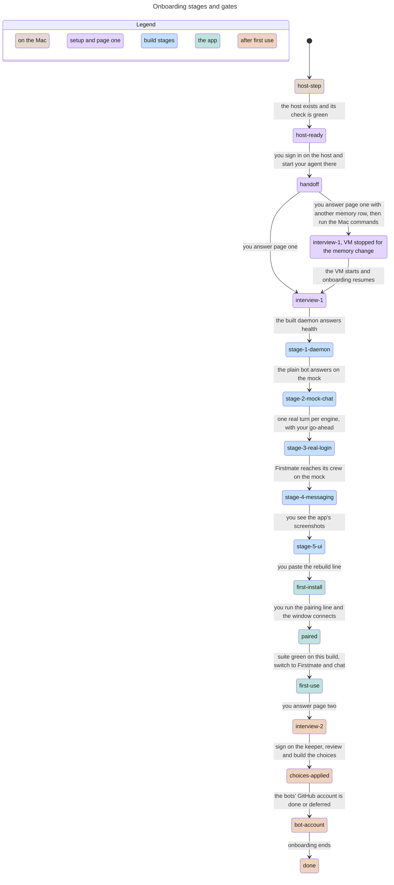

# Onboarding and the interview

Classification: Core. Prerequisites: [host](host.md),
[VM](vm.md) when chosen, the selected engine adapters,
[starter bots](starter-bots.md).

## Purpose

Take a person from a repository link to a harness they trust, in an order that
shows it working before asking for anything that can wait. The person
gives the repository to their own agent and says they want their own harness;
the agent interviews them and builds it. This section owns the
questions asked before anything is installed, the interview pages, their order
and defaults, the stages and their gates, the interview record, the display
name and the plain bot's name. Each choice section owns its own question and
default; [host](host.md) and [VM](vm.md) own what the host step installs;
[app build](app-build.md) and [app pairing](app-pairing.md) own the app steps.

## Required behaviour

- **R1 — Before anything is installed.** The person's agent on the Mac first
  states, in a few lines, what the harness needs: an Apple Silicon Mac,
  isolation from the computer the person works on, and for the supplied VM its
  memory row for this Mac and a disk file that grows to at most 100 GiB
  ([VM](vm.md) R3). It then asks, in chat, the host-step questions:
  1. `power`: how the bots will be powered: Claude models through Claude Code
     on the person's own login, OpenAI models through Pi signed in with
     ChatGPT, or an API key for a named provider through Pi; one or more. The
     default is both engines: Claude Code for Anthropic models on the person's
     own Claude login and Pi for OpenAI models signed in with ChatGPT, so the
     person can use either family. BYOH still gives no advice between a
     subscription and an API key: either route can be replaced by an
     API key for a named provider through Pi. The answer selects the adapter
     sections ([engine contract](engine-contract.md)) and the terms wording
     their sections own.
  2. `host`: the supplied VM (default) or a Linux machine of the person's own,
     given by its two SSH names ([host](host.md) R3).
  3. `disk_layout` (supplied VM only): one disk (default) or a separate data
     disk, asked only after the trade-off in [VM](vm.md) R4 is explained,
     because the layout is fixed at creation.
  4. `prevent_sleep` (supplied VM only): macOS's prevent-sleep setting on the
     power adapter, pre-selected ([VM](vm.md) R8).

  For the supplied VM the host step also writes the SSH names file and its one
  `Include` line ([VM](vm.md) R5).

  Before page one the record (R5) holds these answers and both SSH names, and
  no credential travels with them; how they reach the host is the person's
  agent's choice.

  Every question shows its default and "go with the defaults" answers all four
  at once. Nothing from the repository runs on the Mac
  except the pinned host step ([VM](vm.md) R2).
- **R2 — Handoff.** When the environment check is green ([host](host.md) R10),
  the agent prints the command that opens a terminal on the host as the bot
  user (`ssh myharness` for the supplied VM, otherwise the bot SSH name). The
  person signs in there with each engine they chose, using its own sign-in
  ([engine Pi](engine-pi.md), [engine Claude Code](engine-claude-code.md)), and
  starts their agent there with the repository at its pinned tag.
  The pinned tag is the release named in the top-level README. From then on
  the interview, the build and the first chat happen in the host. Before building,
  that agent reads the pinned blueprint's [verification skill](../verify/SKILL.md)
  and uses its isolated kit/evidence workflow at the build stages. The suite
  remains the only pass/fail gate; this adds no stage or real-login permission.
- **R3 — Interview pages.** The interview runs on Lavish pages served from the
  host, through `npx -y lavish-axi@<pinned version>` with its usage data turned
  off, on port 4388, so the page opens in the Mac
  browser at `http://127.0.0.1:4388/...`. For an own host the agent first gives
  the person a one-time forward for that port (`ssh -N -L
  127.0.0.1:4388:127.0.0.1:4388 <bot name>`). A page asks four or five
  questions, each with its default visible and a "Go with the defaults" action
  for the whole page. There are two pages:
  1. Page one, before the first chat: `display_name`, `plain_name` (R6),
     `model` (the default leaves the starter bots' model unset, so
     [engine contract](engine-contract.md) R1 decides: with both engines that is
     Pi's default model on the chosen route, and a Claude Code model is one
     choice away in the [model picker](model-picker.md)), and for the
     supplied VM `vm_memory`, the [VM](vm.md) R3 table with this Mac's row
     selected. Choosing another row gives the person the exact Mac commands to
     run (stop, edit memory, start), because that change happens on the Mac.
     The agent first records page one (R5, `progress` `interview-1`) and only
     then shows those commands, saying that after the restart the person starts
     the agent again in the host and onboarding resumes (R8).
  2. Page two, after the person has used the app (R4): the release-one choices
     in this order, each worded and defaulted by its own section:
     [look and palette](look-and-palette.md), [window behaviour](window-behaviour.md),
     [desktop notifications](desktop-notifications.md),
     [conversation export](conversation-export.md) and [VM backup](vm-backup.md),
     with their follow-up questions. Only choice features the release ships are
     offered; keyboard shortcuts and the phone companion are
     not.

  If the page cannot be served, the agent asks the same questions in chat with
  the same defaults and records the answers the same way.
- **R4 — Stages and gates.** Onboarding moves through these states in order;
  each state is entered only when the previous one's proof passes, and a
  failure stays in its state with what failed named:
  1. `host-step`: R1 answered.
  2. `host-ready`: the host exists and the environment check is green.
  3. `handoff`: R2 done; the agent runs in the host.
  4. `interview-1`: page one answered.
  5. `stage-1-daemon`: the built daemon starts on an isolated instance and
     answers health ([verifiability](verifiability.md)).
  6. `stage-2-mock-chat`: the plain bot answers through each selected adapter
     against the mock model ([starter bots](starter-bots.md) R6).
  7. `stage-3-real-login`: one real turn per selected engine on the person's
     own login, with the person's go-ahead; from here the environment check treats logins as
     required.
  8. `stage-4-messaging`: Firstmate reaches its two crew members and receives
     their replies on the mock model.
  9. `stage-5-ui`: the real app runs on the host's virtual display and its
     screenshots are shown to the person.
  10. `first-install`: the person pastes the rebuild line ([app build](app-build.md)
      R2); the live daemon runs and the app is in `~/Applications`.
  11. `paired`: the person runs the pairing line ([app pairing](app-pairing.md)
      R2) and the window is `connected`.
  12. `first-use`: the person switches to Firstmate in the app under R9, chats
      and sees work done.
  13. `interview-2`: page two answered.
  14. `choices-applied`: Firstmate tasks Bot Maker to sign on a harness keeper
      for `~/myharness-src` from the crewmate template, showing the captain the
      brief, overlap check, files and live check step by step. The keeper
      builds the page-two choices with a Code Reviewer pass, a pull request
      and a merge only on the captain's word. The captain runs the rebuild
      line again and the choices' Mac checks are presented. The keeper keeps
      owning the harness source after onboarding ([starter bots](starter-bots.md) R7).
  15. `bot-account`: the bots' own GitHub account (R7), done or deferred.
  16. `done`.
- **R5 — The interview record.** Answers live in `interview.json` at the root of
  the harness source repository ([app build](app-build.md) R1) and are
  committed with it, so every build uses the answers of its own commit. It is
  UTF-8 JSON, written whole through a temporary file and a rename:
  `{"schema": 1, "progress": "<R4 state>", "answers": {"<id>": <value>},
  "defaulted": ["<id>", ...]}`, where `progress` is the last state passed and
  `defaulted` lists answers taken by default. The ids are those in R1 and R3
  and the ids the choice sections give their questions; the bot and admin SSH
  names are recorded under `host`. The host-step answers and both SSH names
  are in the record before page one (R1). The record holds no credential,
  token or key. Settings that a section stores elsewhere stay there (for
  example `notify` in `myharness.toml`).
- **R6 — Names.** `display_name` is the name the person gives their harness,
  shown throughout the app and in the app's bundle name, never a command or
  path; its default is `My Harness`. `plain_name` is the display name
  of the plain bot, whose id stays `plain`; its default is `plain` ([starter bots](starter-bots.md) R1). Both are accepted when, after trimming
  leading and trailing white space, they hold 1 to 64 characters with no
  control character or line break. An invalid value keeps the page open with
  the reason beside the field and every other answer kept; nothing is written
  until the page is valid. The plain name is written as the plain bot's
  `bot.toml` `name`, escaped as a TOML string. A later change of the display
  name is a record change and a rebuild; a later change of the plain name is an
  ordinary bot edit ([config editors](config-editors.md)).
- **R7 — The bots' own GitHub account.** The agent offers to guide the person
  through creating the bots' account: one machine account the person is
  responsible for, using their inbox through a plus address, two-factor
  authentication with an authenticator app, fine-grained tokens scoped to the
  person's chosen repositories, and a profile saying it is an automation account
  they operate; the token is entered on the host with the GitHub CLI as the bot
  user. The default is to do it later, when a bot first needs GitHub; the agent
  says how to ask for it then.
- **R8 — Resuming.** Running onboarding again with an existing record offers
  the recorded answers as the defaults, starts at the first state after
  `progress`, and never resets a home or renames a bot
  ([starter bots](starter-bots.md) E1).

- **R9 — Switch to the harness.** At entry to `first-use` the live daemon is
  running, the app is installed and paired, and the suite is green on that
  build. The setup agent plainly says it is time to switch from that agent to
  the person's own harness. It prints a complete first message for
  the person to paste to Firstmate in the app, with no unfilled placeholders:
  ask Firstmate to read `~/myharness-src/interview.json`, establish the recorded
  answers and progress, and lead the remaining onboarding from there. The
  message also names the absolute path of the blueprint folder. Firstmate
  writes that path as one MEMORY.md line the first time it reads it, so a
  later R8 resume can find the spec without a new interview field. Both SSH
  names are read from `host` in the interview record, not installed into the
  charter. This is a person message, not a new command or daemon endpoint.
  Read Firstmate's
  address from the [starter table](starter-bots.md) R1.
  The setup agent gives concrete instructions for returning to that existing
  agent on the host; it stays installed. The earlier R2 Mac-to-host handoff is
  not this later switch of coordination point.

  Firstmate uses its seeded resume skill ([starter bots](starter-bots.md) R7)
  to read R5's record rather than ask the person to repeat completed questions
  or pretend its minimal charter contains the answers. Its first reply proves
  that context by identifying actual recorded answers, the last passed state
  and the next unpassed state. First-use work and the remaining gates still
  need their R4 proof; neither a greeting nor the switch alone advances them.
  From this switch onward, the agent in R3, R7 and R8 is Firstmate inside the
  harness: it leads page two, choices-applied and the bots' GitHub account.
  For choices-applied it initiates Bot Maker's harness-keeper sign-on and
  narrates each step to the captain; the keeper, not Firstmate or Bot Maker,
  builds the choices with a Code Reviewer pass and keeps owning the source
  (R4, [starter bots](starter-bots.md) R7). Firstmate includes the absolute
  blueprint path and its `verify/SKILL.md` in the keeper sign-on brief. The keeper
  records that skill path in its project context and uses it for this build and
  later harness changes, without a duplicate skill installation or a new gate.
  Resume remains R8's first state after recorded progress; no new progress
  state, interview field, reset, privilege or automatic deploy is introduced.

## States

The supplied VM. A failed stage proof stays in its state (R4), so it has no
arrow; on an own host there is no memory change.

## Controls

Not applicable; the interview adds no dedicated app controls. It uses Lavish
pages and chat: the setup agent's, then Firstmate's in the app from R9.

## Edge cases

- **E1 — Invalid name.** A display or plain name that is empty after trimming,
  longer than 64 characters or holding a control character is refused with the
  reason, and the person retries on the same page.
- **E2 — Stopping midway.** The record keeps `progress` and the answers so far;
  nothing half-written is left in place of the record.
- **E3 — Host check fails.** An own host that fails the capability check stops
  the setup at `host-step`; the agent offers the supplied VM and never installs
  the harness on the Mac ([host](host.md) E2).
- **E4 — A stage fails.** A failed stage proof stops onboarding in that state,
  shows the evidence and does not skip ahead to the app.
- **E5 — The power answer changes later.** A changed `power` answer changes
  which adapter sections apply; keys of an adapter no longer chosen stop being
  valid configuration ([bots](bots.md) R2), and the change takes effect through
  a rebuild.
- **E6 — Defaults all the way.** The all-defaults path produces both engines
  (Claude Code on the person's Claude login, Pi signed in with ChatGPT), the
  supplied VM with one disk and prevent-sleep on, the display name
  `My Harness`, the plain bot named `plain`, the starter bots' model unset (R3),
  this Mac's memory row, every choice at its section's default and the GitHub
  account deferred. Both engines then need their sign-in before
  `stage-3-real-login`.

| Id | Given | When | Expect |
| --- | --- | --- | --- |
| **T1 — Host answers precede page one** | Host-step answers and both SSH names, no credentials, handed from Mac to host | Before showing page one, inspect the source-root interview record | Record R1 answers and both SSH names in R5 interview.json before page one. Preserve the outcome without requiring a particular transport file/mechanism or sending a credential (R1, R5). |
| **T2 — Memory restart keeps page one** | Supplied VM and page-one answers selecting a different memory row | Before Mac commands, read record; restart as instructed and resume | Keep page one with progress interview-1 before showing stop/edit/start commands. After restart offer recorded defaults and resume at stage-1-daemon, without losing answers/resetting a home (R3, R5, R8). |
| **T3 — Real login is not mock proof** | Each selected engine installed on the chosen host and the person's go-ahead | Prove stage-3-real-login in the real-host rehearsal | One real turn per selected engine uses the person's own native login under adapter terms; do not pass the stage on a mock turn or absent go-ahead. Keep credential/token bytes out of the record/evidence, and a failed proof stays in its stage (R4, R5, E4; [engine Pi](engine-pi.md) R5, R6; [Claude Code](engine-claude-code.md) R6, R7). |
| **T4 — First use switches the coordinator** | Live daemon, installed/paired app, suite green on this build and R5 record | Setup agent gives the hand-over, then the person sends the complete first message to Firstmate | State the switch plainly, give the ready-to-send record/resume request and return-to-setup instructions. Firstmate's seeded skill reads actual answers/progress and first reply proves context/next state. Complete first-use proof, then page two/choices/account inside the harness, preserving R8 resume and all gates (R4, R5, R8, R9; [starter bots](starter-bots.md) R7). |

Proof: `suite/onboarding.mjs` holds the mock stage smokes: daemon health against its discovery file; the plain bot installed and answering through each selected engine; the installed starter files contain no unresolved placeholders and include NOTICE.md; the crew wired as a led team, with a round trip that records bridges; and the real app on the virtual display showing the bots tree and opening a chat. Evidence: JSON, plus PNG and the accessibility tree for the window. Stage 3 real login, the host step on a fresh Mac, the Lavish pages, the interview record and the first-use hand-over are not suite cases: check them in the real-host rehearsal, where Mac items stay mac-pending until answered.