# Scheduled and one-shot prompts

Classification: Core. Prerequisites: configured bot, daemon and valid default time zone.

## Purpose

Run a saved prompt on a schedule without treating a missed run as completed
work. This section owns routine files, scheduler semantics, editor and global
routine views. The [config-editors](config-editors.md) section owns shared file save/conflict
controls and the bot panel's entry/list/create actions.

## Required behaviour

- **R1 — Definition.** `bots/<bot>/routines/<name>.md` has YAML mapping front
  matter and a Markdown prompt body. Known fields: `name` (display title,
  default filename stem), `description` (default empty), required `schedule`,
  `tz` (default global zone), `enabled` (boolean, default false), `session`
  (default title), `folder` (optional string). Trim schedule and collapse its
  whitespace; trim body. Invalid front matter, unknown fields, missing/invalid
  schedules, invalid IANA zone and nonboolean enabled are diagnostics.
- **R2 — Schedule grammar.** Accept standard five-field cron: minute, hour,
  day-of-month, month, day-of-week. Also accept an actual calendar date
  `YYYY-MM-DDTHH:MM[:SS]` as a one-shot. Both are read in the routine's zone, not
  UTC. Preview and execution use the same calculation, and a clock change never
  runs one selected time twice. Owner POST `/routines/preview` accepts
  schedule/tz and returns next local occurrences or a useful error.
- **R3 — Delivery and session.** At a due time send the bot a prompt framed
  `[routine <name> · <local date/time and UTC offset>]` then newline and body.
  `session` first matches an existing full id of this bot; `fresh` makes a new
  routine-origin session per run with title plus local scheduled time. Otherwise
  reuse a session with that title owned by this routine, or create it. `folder`
  applies only to newly created sessions. Routine delivery is not person queue input.
- **R4 — Overlap and missed time.** Automatic execution requires enabled true.
  Never overlap two currently running executions of the same routine in this
  daemon: record `skipped-overlap`. After a delayed recurring tick, record
  earlier due times as missed and attempt only the latest (up to 1000 due
  occurrences considered per interval). At startup, if an enabled recurring
  routine has a prior run record of any status, log the occurrences since the
  last one as missed, the oldest 50 when there are more, without executing a
  backlog. The count starts at that last record whatever happened since, so a
  stretch with the routine switched off also shows as missed; the
  missed records themselves are run records, so the next startup counts from
  them. No prior record means no invented historical runs.
- **R5 — One shot.** A due one-shot waits while that routine is busy, then
  attempts once.
  Once attempted, delete its Markdown and run-log files, including after a
  could-not-start result or manual Run now. A one-shot whose attempt is
  already recorded is removed at the next check, also after a daemon restart,
  and is never attempted again. Retain the Markdown in local
  configuration history before deletion. Do not advertise a future run after
  removal. This consumes a one-shot, not a guarantee its model succeeded.
  A one-shot that misses its time does not run and says so visibly: an enabled
  one-shot whose due time passed while the daemon was stopped is consumed as a
  failure the person can see, not run when the daemon returns. A
  one-shot prompt whose engine could not start is never delivered on a later
  start, and that failure stays visible after its files are removed. A
  one-shot waiting while its routine is busy has not missed its time, and still
  runs after the wait.
- **R6 — Manual execution and evidence.** Owner POST
  `/routines/<bot>/<name>/run` and CLI `routine run <bot>/<name>` run even when
  disabled, subject to overlap; missing routine is 404. CLI prints status and
  session. `GET /routines[?bot=<id>]` and `routines [bot]` expose enabled state,
  schedule, zone and upcoming times; API includes five next times and recent
  twenty runs, CLI shows up to three upcoming UTC times when enabled.
  `<name>.runs.jsonl` retains up to 500 records with `ts`, `session`/null,
  `status` (`started`, `skipped-overlap`, `missed`), `ended`/null and optional
  `manual`. Settlement stamps ended; started without ended means running or
  unfinished, not necessarily success.
- **R7 — Views and edits.** A form and raw Markdown editor address the same
  file; changes stay drafts until Save. Show schedule preview/errors, recent
  runs and Run now. Global List/Calendar/Run logs views filter by bot; logs
  additionally search title/bot case-insensitively. Calendar shows the current
  Monday-based week, prior/next week and Today, using viewer-local dates/times;
  scheduled calculation still uses routine tz. Toggling enabled writes only
  that file setting. Run rows with session ids open the conversation; missing
  session rows are not fake navigation. Empty views say no routines/runs.

## States

```mermaid
---
title: "Routines: due times, missed runs and one-shots"
---
stateDiagram-v2
  direction LR
  state "At the same time" as all {
    state "Daemon" as r0 {
      s0: Running
      s1: Stopped
      [*] --> s0
      s0 --> s1: the daemon stops
      s1 --> s0: the daemon starts
    }
    --
    state "Routine" as r1 {
      s2: On
      s3: Off
      s4: On, run in progress
      s5: Off, run still finishing
      [*] --> s2
      s2 --> s3: you switch it off
      s2 --> s4: a due time passes [when Daemon is Running]
      s3 --> s2: you switch it on
      s4 --> s2: the daemon stops or the run ends
      s4 --> s5: you switch it off
      s5 --> s4: you switch it on
      s5 --> s3: the daemon stops or the run ends
    }
    --
    state "One-shot" as r2 {
      s6: Waiting
      s7: Attempted, file not yet removed
      s8: Used up
      [*] --> s6
      s6 --> s7: the one-shot is attempted [when Daemon is Running and Routine is one of Off, On]
      s6 --> s8: it expires; failure recorded [when Daemon is Running and Routine is On]
      s7 --> s8: its file is removed [when Daemon is Running]
    }
    --
    state "Run log" as r3 {
      s9: No missed runs
      s10: Missed runs logged
      [*] --> s9
      s9 --> s10: the startup check logs missed runs [the routine is on, has a run record, and a due time passed]
    }
  }
```

One recurring routine and one one-shot; the parts change together where an arrow
says so. The startup check counts from the last run record, so due times while
the routine was off are logged too (R4); an attempted one-shot is removed after
a restart and never attempted again (R5).

## Controls

Scope repeated actions to a region named `Routine <bot>/<name>` and run
navigation to its timestamp; names do not rely on unique display titles.

| Role | Accessible name | Scope, action and observable state |
| --- | --- | --- |
| button | Form / Text | Two separately named editor buttons; pressed state selects mode. |
| checkbox | Fire on schedule | Editor; checked means enabled draft. |
| textbox | Name / Description / Schedule / Time zone / Session / Folder | Six separately named editor fields. |
| textbox | Routine message | Form prompt body, multiline. |
| textbox | Routine source | Raw Markdown editor, multiline. |
| button | Run now | Editor or routine card; explicit manual execution. |
| button | List / Calendar / Run logs | Three global view buttons, selected pressed state. |
| combobox | Filter routines by bot | All bots or one id. |
| searchbox | Search run logs | Run logs view. |
| switch | Enable routine | Routine card; checked state reflects saved enabled setting. |
| button | Edit | Routine card; opens bot routine editor. |
| button | Previous week / Today / Next week | Three calendar navigation buttons. |
| button | Open run <timestamp> | Run with a session, within its routine region. |
| button | Edit routine <bot>/<name> | Upcoming calendar occurrence, within dated calendar region. |

Shared Save, Reload, Keep mine and file actions are specified by [config-editors](config-editors.md), not separate routine-specific controls.

## Edge cases

- **E1 — Invalid draft versus saved state.** Preview errors are visible; typing
  does not run a schedule. Saving invalid bot-local routine config exposes the
  home last-good diagnostic gate, not a hidden successful schedule.
- **E2 — Schedule changes and failure.** Read live definitions; disabling stops
  future automatic triggers, not an already running turn. A failed launch
  leaves an explicit run/incident outcome; a deleted one-shot can be inspected
  through history, not silently retried every second.
- **E3 — Time boundaries.** Preview must show zone/offset, so ambiguous local
  clock times are not mistaken for UTC. Preview and execution share R2's
  calculation; daemon downtime uses R4 and R5, not an
  exactly-once-across-crashes claim. Run completion does not mean task success.

| Id | Given | When | Expect |
| --- | --- | --- | --- |
| **T1 — Failed one-shot start is final** | A due one-shot has a target session; its engine cannot start | Attempt once, then repair the engine and start/restart later | Consume the routine/run log and never deliver that failed prompt later. Keep the source failure visible through its existing marker/detail and attention surface, subject to the normal failure/mark lifecycle (R5, E2; [failure alerts](failure-alerts.md) R1, R6; [status](status.md) R1, R3). |
| **T2 — Missed during downtime** | Enabled one-shot whose due time passed while the daemon was stopped | The daemon starts | Consume it and show the person the failure. It does not run, then or on a later start (R5). |
| **T3 — Routine-local session selection** | Enabled due recurring routine or on-time one-shot; a same-title unrelated/other-bot session exists | Select full id, fresh, default title or another title | Match full ids only within this bot; otherwise use fresh or a title owned by this routine, not an unrelated session. Frame local scheduled date/time and UTC offset plus body; folder applies only on creation (R1, R3). |
| **T4 — Manual run, overlap and busy wait** | Disabled/future one-shot or recurring routine; same-name execution can be held busy | Run now, automatic trigger or rearm during the prior execution | Manual run ignores enabled; automatic trigger requires enabled. Do not overlap the same routine; record overlap under R4. A due/rearmed one-shot waits for the busy routine, then attempts once and is consumed with history, not cancelled by elapsed time (R4–R6). |
| **T5 — Grammar, zones and useful errors** | Five-field cron or local one-shot date, with valid/invalid zones and calendar values | Validate and preview selected instants | Use R2's grammar and the routine's zone, including optional seconds. Reject malformed date/cron and invalid zone with the R1/R2 diagnostics; show zone/offset, not an assumed global fixture zone (R1, R2, E3). |

Proof: `suite/routines.mjs` restarts the daemon around due times and checks: due times passed while the routine is off, or while the daemon is stopped, are logged once as missed without a run; a one-shot whose engine cannot start is consumed and not run again. It does not drive the window. Evidence: JSON.