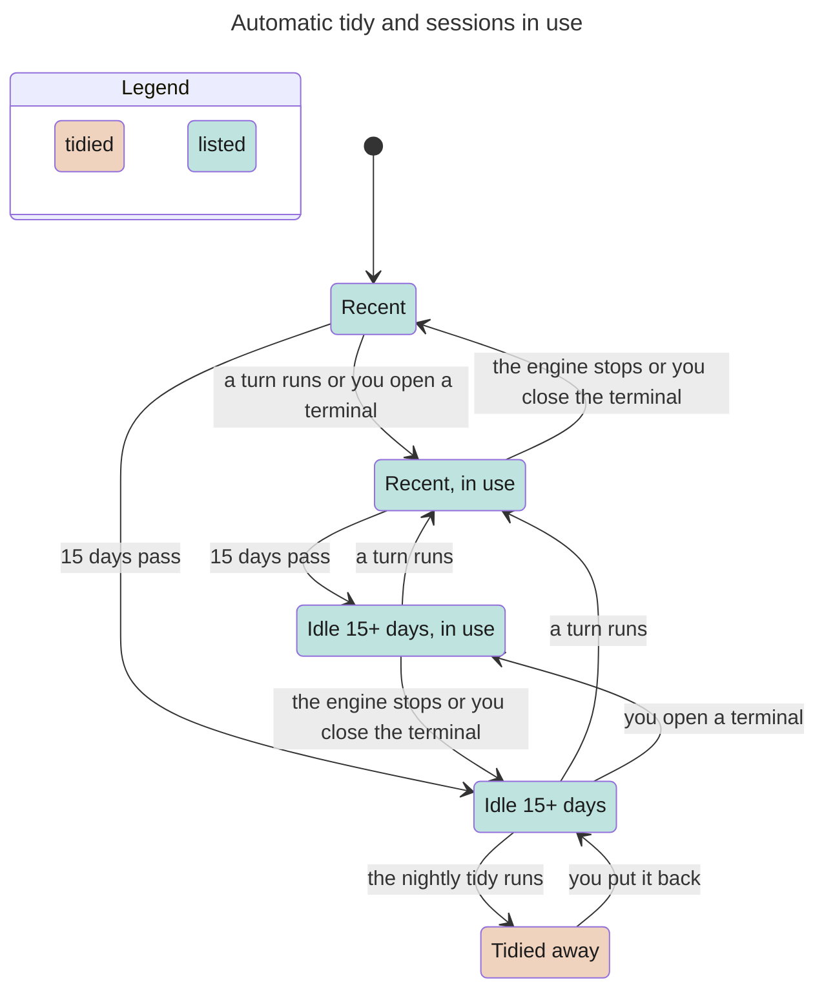

# Permanent idle-session archive

Classification: Core. Prerequisites: initialized home and writable archive on
the same host.

## Purpose

Recover disk space from old session scratch while keeping conversations
restorable. This is different from [session-organization](session-organization.md)'s
soft archive flag. **Tidy permanently deletes each chosen session's `work/`
scratch; put-back cannot restore it.** Do not store irreplaceable work there.

## Required behaviour

- **R1 — Selection.** `myharness tidy [--days N]` selects sessions idle for
  strictly more than N 24-hour days; default 15, positive finite N required.
  Use `last_turn` or, if null, `created`. At exactly the cutoff do not archive.
  Soft-archived sessions are also eligible. Re-read the metadata immediately
  before moving and skip a session whose timestamp is no longer stale.
  Selection is timestamp-based, not a new running-process/queue exclusion.
  Run tidy when the instance is quiescent; this offline command is not a
  concurrency-safe live-session maintenance API.
- **R2 — Destination and contents.** Archive permanently at
  `<home>/session-archive/<local-YYYY-MM-DD>/`, excluded from instruction Git
  history. Keep metadata, native transcript, RPC/prompt snapshots, pending,
  outbound/incoming ledgers, attachments and other session-owned artifacts
  that exist. Preserve home-relative paths; an engine transcript outside home
  uses `@outside/` with its original absolute path below that directory.
  `@sessions/<bot>--<uuid>.json` is a UTF-8 JSON object with exactly these fields:

  | Field | Type and meaning |
  | --- | --- |
  | `bot` | Bot id string. |
  | `id` | Session UUID string. |
  | `title` | Session title string. |
  | `tidied` | ISO timestamp string of the archive attempt. |
  | `moved` | Array of `{from, to}` objects, both strings, one per moved artifact. |

  A `from` inside home is home-relative; an engine-external `from` remains
  absolute. Every `to` is home-relative and identifies its dated
  `session-archive/` slot, including `@outside/` for an external artifact.
  Resolve relative paths against the currently selected home on restore,
  never against the installation path at archive time. Delete `work/` before
  moving, never archive its bytes. Nothing expires automatically. Manifest
  paths are relative to the home.
- **R3 — Listing and restore.** `myharness tidy --list` lists archive date,
  bot, id prefix and title plus total/location. `--put-back <id-or-prefix>`
  accepts at least four initial characters. Match a unique archived UUID,
  preferring the newest archive of that same UUID if repeated. Refuse any
  existing original destination before moving files; no overwrite or merge.
  For an external absolute destination, require its parent directory still to
  exist; fail clearly without recreating it or restoring any files if not.
  Check missing archived sources before restoration too.
  Restore all recorded artifacts except deleted scratch, remove the successful
  manifest and prune empty date directories, and state explicitly that work/
  was not restored. Session identity/title and conversation remain intact.
  The metadata comes back unchanged, including `last_turn`, so a session put
  back and not used since is selected again by the next run (R1).
- **R4 — Output and errors.** Tidy prints each moved bot/id/date/title and a
  final moved count/location. With per-session errors, continue other sessions
  and finish nonzero with the failures named. On a partial move attempt, try
  to roll moved files back and report any stranded paths. An archive collision
  is an error, not an overwrite. Neither rollback nor put-back can recover
  work/ deleted before the error; the warning applies to failed attempts too.
- **R5 — Placement and scheduling.** The archive stays inside the selected home,
  on every kind of host, so moving the home moves its archive.
  `--at-login` is not part of the core Linux CLI. Automatic invocation is the
  host's nightly job in [host](host.md) R7; no Mac LaunchAgent is installed. A
  scheduling mechanism must not be inferred from a manual archive command.
- **R6 — Offline boundaries.** Tidy requires no model or daemon connection and
  does not start/stop a live service. The archive includes session runtime, not
  instruction history; putting a session back does not roll back bot config.
  Archived uncertain delivery remains uncertain, not authority to replay it.

## States

One session and the nightly job. In use means a live engine, a terminal holding
it or input waiting for it ([host](host.md) R7). When the daemon is not running
the night proceeds without that check (E4). A manual run (R1) has no
in-use check and is not shown.

## Controls

Not applicable; archive/list/put-back are CLI operations. Soft archive UI controls belong to [session-organization](session-organization.md).

## Edge cases

- **E1 — Prefix and malformed records.** Too-short restore ids are usage errors;
  no match or distinct-UUID ambiguity fails without moving files. Unreadable
  archive manifests are not advertised as restorable sessions. Missing source
  files during restore are visible errors, not an invented complete restore.
  A removed external parent is not silently recreated; an existing destination
  file is never overwritten, including engine-external destinations.
- **E2 — Relocation and backup.** The archive travels with the selected home
  on relocation; its internal manifest paths restore into the current home,
  not the old home. Engine-external paths stay absolute and are not an
  automatic native-path migration. Chosen
  [VM backup](vm-backup.md) pulls the home including this
  archive; without backup, deleting the one-disk VM loses the archive too. “Permanent”
  means no automatic expiry, not survival of deleting the host/disk.
- **E3 — Scratch loss.** Restore recreates conversation artifacts, not deleted
  work/ content. An interrupted/failed archive can still have deleted scratch;
  do not say “nothing changed” or offer history as an undo for scratch.
- **E4 — Clock and activity.** Compare parsed instants, not day labels or folder
  names. Invalid dates are not evidence of 15 days idle. No active-session
  exclusion is promised by the timestamp algorithm; the host job addresses
  quiescence by skipping a night when any session is in use: a live engine, a
  terminal holding it, or input waiting for it ([host](host.md) R7), rather
  than assuming the offline command locks turns. A terminal left open for weeks
  therefore holds off automatic tidy until it closes; a manual run has no such
  check (R1). When the daemon is not running the night proceeds: a terminal
  opened without the daemon is not detected, and input left waiting moves into
  the archive with its session and returns with put-back.

| Id | Given | When | Expect |
| --- | --- | --- | --- |
| **T1 — Cutoff and refreshed candidate** | Old, exact-cutoff and recent sessions; a selected candidate's metadata changes | Run tidy with default or valid days, re-reading immediately before move | Only strictly stale last_turn-or-created qualifies; exact cutoff and refreshed candidates are skipped. A skipped candidate keeps its scratch; the command still requires quiescence, not a live-session lock (R1, E4). |
| **T2 — Empty selection** | No stale sessions qualify | Run manual tidy | Report zero moved and the archive location; this empty manual run is not proof of automatic scheduling (R4, R5). |
| **T3 — Nightly terminal hold** | Daemon reachable; a terminal holds a session and stale candidates exist | Host's nightly job reaches its in-use check | Move nothing in that run, log which session is held and why, and wait for the next night. This is the host-job rule, not an added manual-tidy exclusion (E4; [host](host.md) R7). |
| **T4 — Nightly input waiting** | Daemon reachable; durable input waits for pickup and stale candidates exist | Host's nightly job reaches its in-use check | Move nothing, log the session and waiting-input reason, then wait for the next night. The daemon-absent exception remains E4; manual tidy remains timestamp-based (R1, E4; [host](host.md) R7). |
