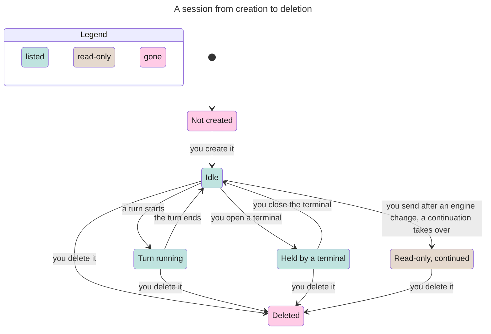

# Sessions and durable identity

Classification: Core. Prerequisites: a configured bot and initialized home.

## Purpose

Keep conversations addressable across app and daemon restarts. This section
owns session identity, metadata and deletion; [session-organization](session-organization.md)
section owns folders and soft archive controls, and [conversation branching](conversation-branching.md)
owns fork/duplicate semantics. [Session tidy](session-tidy.md) is a distinct disk archive.

## Required behaviour

- **R1 — Creation.** Owner `POST /bots/<bot>/sessions` accepts optional `title`
  and `folder` and returns persisted metadata with a new UUID. Default title
  is `New session`; origin is `person`. `myharness new <bot> [--folder F]
  [--title T]` prints the full UUID. Creating a session does not start a model.
- **R2 — Metadata.** `bots/<bot>/sessions/<uuid>.json` records `id`, `title`,
  `file` (native transcript filename/path or null), `folder` (string/null),
  `origin` (`person`, `bot`, `routine`, `fork`), `created`, `last_turn`,
  `reply_to` (`{bot,session}`/null), `forked_from` (`{session,entry}`/null),
  `routine` (name/null), `archived`, `unread`, and `contract` (prompt contract
  version). New sessions have null last turn, no transcript, false archive and
  unread. Timestamps are ISO instants with offsets; ordering compares parsed
  instants, not lexical local times. Daemon turn start/settle updates last_turn.
- **R3 — Native state and workspace.** The first run records its `engine`;
  a durable `launch` record captures requested and effective model/thinking and
  any refusal notice without rewriting bot config. Engine sections own native
  transcripts. Session scratch is `bots/<bot>/sessions/<uuid>/work/`, supplied
  to the child as `MYHARNESS_WORKSPACE`. Session-associated attachments and
  pending/outbound/incoming records belong to that session, not bot notes.
  Restart reopens persisted transcripts and metadata; no automatic replay of
  uncertain model input is implied ([turns](turns.md)).
- **R4 — Lookup.** Exact UUID wins, then a unique id prefix, then exact title.
  Multiple id-prefix matches are an error requiring a longer id, not newest
  selection. Duplicate titles resolve to the first session in recency order.
  `latest` selects the most recent non-soft-archived session or creates one if
  there is none. Lists order by `last_turn`, falling back to `created`, newest
  first. Printed prefixes start at eight characters and lengthen to distinguish
  all sessions of that bot, including archived rows.
- **R5 — Lists and updates.** `GET /bots/<bot>/sessions` returns `index` and
  `sessions` including soft-archived rows; `GET /sessions/<bot>/<ref>` returns
  session detail and transcript/state.
  Reading a missing or deleted session answers 404. The transcript is `messages`, a list in
  transcript order; each entry has at least `entry` (a stable id of that
  transcript entry), `role` (`user`, `assistant` or another engine role),
  `text` (its plain text) and `toolCalls` (a list, empty when none, whose
  items have at least the tool `name`). CLI `sessions <bot> [--folder F] [--all]`
  excludes soft archive by default, prints readable rows (prefix, time, folder,
  title, applicable live/running/unread/origin/status), or explicit zero count.
  PATCH on the session accepts nonblank trimmed `title`, `folder` string/null,
  `archived` boolean, `unread` boolean, and `idle: true`, the Mark as read
  of [status](status.md) R3, which owns its rules.
  Renaming preserves the UUID and mirrors to a live engine's session name.
- **R6 — Engine continuation.** A native transcript is not resumed on an
  incompatible engine. When the configured engine changes and the old process
  is no longer live, new input resolves to a continuation with a new UUID,
  preserving title/origin/folder/routine/reply address, not rewriting the old
  transcript. Old `continued_as` and new `continues` identify the lineage.
  Old views are read-only and offer their continuation. Pending unsent input
  follows the lineage; details belong to turns/messaging and engine-contract.
  Changing the configured engine does not stop an existing live process; further input to that process stays on its recorded engine.
- **R7 — Deletion.** Owner DELETE on a session stops its live engine and removes
  metadata, owned native transcript, RPC/prompt/pending/outbound/incoming files,
  workspace, session attachments and the session's app recovery copies
  ([turns](turns.md) R8). Do not delete unrelated native files or
  bridge logs. Soft archive is not deletion. Deletion is not undoable via history.
  A session can be deleted while a terminal holds it
  ([terminal chat](terminal-chat.md) R2): deletion stops the daemon's engine and
  removes the session, a terminal still open keeps running on its own
  transcript, and the harness loses track of it.

## States

One session. Idle 15+ days, the nightly tidy and put-back are drawn in
[session tidy](session-tidy.md); a read-only continued session is
tidied and put back the same way. Deleting a session held by a terminal leaves
that terminal running on its own transcript (R7). Not shown: Archive and
Unarchive ([session organization](session-organization.md) R4), which only hide
or show the row (a turn start unarchives it).

## Controls

The [shell](ui-shell.md) owns creation/navigation and session-organization owns
rename/archive/delete row menus and their confirmations. This section owns only
read-only continuation recovery within the conversation region:

| Role | Accessible name | Scope, action and observable state |
| --- | --- | --- |
| button | Open continuation | Read-only old session with an extant continuation; opens that UUID. |
| button | New session | Read-only old session whose continuation is missing; creates a new person session. |

An unselected conversation says to choose a session; it is not a send target.

## Edge cases

- **E1 — Missing or ambiguous.** Missing bot/session is a visible API/CLI error;
  an ambiguous prefix returns no arbitrary session and mutates none. Malformed
  metadata is omitted from read-only listings, not repaired by listing.
- **E2 — Orphans.** A native Pi transcript with a UUID and no metadata can be
  adopted as `Untitled session` with person origin; its text is preserved.
  This is recovery, not a claim every malformed native transcript is repairable.
- **E3 — Retired chain.** If a continuation was deleted, the old session stays
  readable but cannot silently start on the wrong engine. State that the target
  no longer exists and offer New session; do not loop through broken chains.
- **E4 — Persistence scope.** Closing the window or daemon is not deleting a
  session. The home history does not contain runtime transcripts; it cannot
  restore a deliberately deleted conversation.

| Id | Given | When | Expect |
| --- | --- | --- | --- |
| **T1 — Activity and instant order** | Old and recent sessions with differently offset timestamps | Person, bot or routine turn starts/settles; list sessions | Update last_turn at start and settlement; compare parsed instants, falling back to created only when last_turn is null. Do not rank by local timestamp strings or creation alone (R2, R4). |
| **T2 — Engine change with or without a live process** | A session has a recorded native engine; configuration selects a different engine | Read the old conversation, then deliver new input before/after its old process exits | Configuration change does not stop the live process; further input stays on its recorded engine (R6). Keep reading with that engine; never resume an incompatible native transcript. Once the old process exits, resolve new input to a new-UUID continuation preserving title/origin/folder/routine/reply address; after continuation the old view is read-only (R6; [engine contract](engine-contract.md) R1). |
| **T3 — Colliding or hidden prefixes** | Sessions of one bot share id prefixes or titles, including archived siblings | Print ids or resolve an ambiguous prefix | Printed prefixes lengthen to distinguish every session, including archived rows. Ambiguity requires a longer id, never an arbitrary newest selection or mutation; exact UUID still wins (R4, E1). |

Proof: `suite/sessions.mjs` checks: after a daemon restart the sessions, titles, transcript and latest session are unchanged and a new turn continues without replay; each session has its own workspace; an idle engine exits while sessions stay; deleting a session removes its own files and changes nothing else. Evidence: JSON.