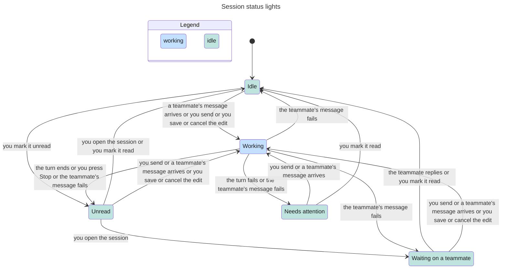

# Session status and unread marks

Classification: Core. Prerequisites: [sessions](sessions.md), [turns](turns.md),
[messaging](messaging.md).

## Purpose

Distinguish actual work, requests for the person and teammate waits from unread
replies. Status is an aid to navigation, not proof that a model succeeded or a
peer received an input. Bot marks are deterministic identity pictures owned by
[bots](bots.md); this section owns the status lights beside them.

## Required behaviour

- **R1 — Session precedence.** Derive one status per session: working when a
  turn runs or dispatchable queued work exists. Dispatchable queued work is
  bot-origin input waiting for pickup without an error ([messaging](messaging.md)
  R6); the person's paused or edit-blocked follow-ups ([turns](turns.md) R2, R4)
  and errored input do not count. Otherwise a manual idle mark suppresses
  transcript/failure inference, yielding unread if marked unread, else idle.
  Without that mark: failure is attention; an unanswered question to the
  person is attention; unread precedes waiting-on-teammate; otherwise idle.
  Show meaningful detail for attention/waiting, not colour alone.
- **R2 — Transcript inference.** For a non-reply-to-bot thread, a final assistant
  reply without error whose last nonempty line ends in a question mark
  (ignoring Markdown decoration and trailing quotes/parentheses) asks the person.
  Ignore compaction records when choosing the last message. Waiting means the
  last assistant send_message to a teammate other than the thread's reply-to
  bot has no later incoming reply from that bot; a failed tool result does not
  create a wait. Routine threads do not infer teammate waiting. This is a
  heuristic, not semantic proof that every question or task was understood.
- **R3 — Unread and idle.** Finishing a non-routine turn with no attached app
  viewer sets unread; a turn ended by Stop, a failure or an engine exit
  finishes too ([turns](turns.md) R4). An existing unread mark is retained. Viewing the session
  clears unread, but not an inferred question/failure. Person input clears
  unread; turn start clears a manual idle mark and prior failure. Mark as read
  explicitly records idle and clears unread; it is owner PATCH on the session
  with `{idle: true}` ([sessions](sessions.md) R5), and is rejected with 409
  while running or dispatchable queued work (R1) exists. Idle sessions offer Mark as unread;
  waiting/attention/unread offer Mark as read; working offers neither. These
  marks never cancel a turn, delete content or send a reply. The [completion
  sound](completion-sound.md) is separate and keys off the working-to-unread change;
  the chosen [desktop notifications](desktop-notifications.md) key off the unread
  mark a finished turn sets.
- **R4 — Bot aggregate.** Aggregate non-archived session states in priority order
  attention, working, unread, waiting, idle. Show the first state of the winning
  kind and its count when more than one; do not use the most recent thread as
  a substitute. A bot's unread count can include archived sessions even though
  its aggregate excludes them. Bot Mark as read targets all eligible
  non-archived sessions, not just the currently open one; concurrent sessions
  becoming working are refused individually and state is refreshed.
- **R5 — Active sessions.** Active sessions lists each non-archived working,
  waiting or attention session across bots, preserving bot discovery order
  and each bot's session list order. Unread-only/idle sessions are not active.
  Selecting a row opens that exact bot/UUID. A live but idle process is not
  necessarily active. The entry is lit when any listed session is working.
  Empty successful reads explicitly say none are working/waiting/asking.

## States

One session that is not open in a window: an open session does not become Unread
when its turn ends (R3). Where one label leads to different lights, earlier
state that the light does not show decides: an earlier failure, a teammate wait,
an unread or idle mark, or a held follow-up. Not shown: a question to the
person, which leads to Needs attention like a failure (R2), and routine threads,
which never show Waiting on a teammate (R2).

## Controls

Session row menus are owned by [session-organization](session-organization.md),
bot menus by [shell](ui-shell.md); this section supplies their mark actions.

| Role | Accessible name | Scope, action and observable state |
| --- | --- | --- |
| img | Working / Unread | Status beside bot/session; winning state, never decorative-only. |
| img | Needs attention: <detail> / Waiting on a teammate: <detail> | Status with reason; aggregate count inserted as ` (<n> sessions)` before colon when greater than one. |
| menuitem | Mark as unread / Mark as read | Session actions; eligibility in R3. |
| menuitem | Mark as read | Bot actions; all eligible non-archived sessions. |
| button | Active sessions | Sidebar; expanded when popover open. |
| dialog | Active sessions | Session list; outside click or Close dismisses. |
| button | Open <bot>/<sid> | Active sessions dialog; display bot name, session title and status. |
| button | Close | Active sessions dialog only. |

Idle has no light; a missing light is not a success assertion. Aggregated Working
and Unread names append ` (<n> sessions)` when count is greater than one too.

## Edge cases

- **E1 — Marks versus model.** Mark as read can suppress a question/failure but
  cannot cause another engine pickup. A later turn makes inference live again.
  Marking a working thread idle is a conflict, not a silent forced stop.
- **E2 — Archive and routine.** Archive can hide active status without killing
  the process; next turn start unarchives. Routine completion alone does not
  produce ordinary unread. Active sessions can be empty while an engine is idle.
- **E3 — Races.** If an active session leaves while the popover is open, remove
  that row without switching to another UUID on activation. Refresh after bulk
  marking; a refusal is not proof every thread was marked.

| Id | Given | When | Expect |
| --- | --- | --- | --- |
| **T1 — Infer from the original message** | Final replies, sends and incoming sender-framed replies, possibly batched natively | Derive question/waiting status and inspect incident request content | Only the R2 final-line question heuristic asks the person. Failed sends, replies to the thread's reply-to bot and routine threads do not create teammate waits; an actual incoming peer reply ends its wait. Read the original sender/body, not a batch wrapper as person text (R2; [failure alerts](failure-alerts.md) R4). |
| **T2 — Session precedence differs from bot priority** | Running/queued, paused/errored, marked, failed, unread and waiting sessions, including archives | Derive each state, then aggregate the bot | Running/dispatchable work is working; paused/edit-held/errored input alone is not. Then manual idle, failure/question, unread, wait, idle follow R1/R3. Aggregate non-archived attention before working/unread/waiting/idle, showing first winning-kind session and count, not merely newest thread (R1, R3, R4). |
| **T3 — Marks without mutating work** | Known idle, waiting/attention/unread or working session | Offer/activate marks, view or start a new turn; race a working/deleted target | Offer only R3-eligible actions; Mark as read records idle/clears unread, working refuses 409. Viewing clears unread, not inferred failure/question. Turn start lifts idle/prior failure. Marks never cancel/delete/send a reply or substitute another UUID; refresh after refusal (R3, E1, E3; [session organization](session-organization.md) E3). |
| **T4 — Bulk mark is not current-only** | Non-archived eligible sessions, including a routine with attention, plus working/idle/archived sessions | Bot Mark as read; one eligible session becomes working | Target all eligible non-archived sessions, not just the open one. Refuse the newly working session individually, keep other eligible targets and refresh state; a refusal is not proof every thread was marked (R3, R4, E3). |

Proof: `suite/status.mjs` reads session state through the API and checks that bot input failed before pickup, and a follow-up paused after Stop, do not count as working, so Mark as read is accepted. It does not check the window lights. Evidence: JSON.