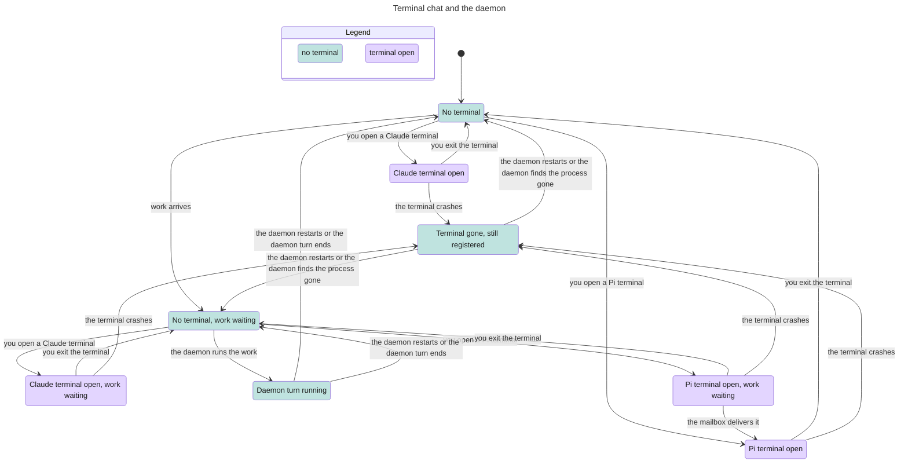

# Terminal chat

Classification: Core. Prerequisites: an initialized bot and selected native engine;
daemon for messaging.

## Purpose

Open the engine's own terminal UI on a persistent bot conversation. Pi supports
incoming mailbox delivery while attached. Claude terminal chat has a narrower
contract: it can send through MCP, but does not inject incoming messages into
its interactive UI. Both must avoid concurrent native transcript writers.

## Required behaviour

- **R1 — Command and target.** `myharness pi <bot> [session]` is the fixed
  terminal-chat command for either adapter, not a request to switch to Pi.
  Without a session create a person-origin `Terminal session`; otherwise resolve
  the bot's session using [sessions](sessions.md)'s rules. Refuse a nonexistent,
  retired or incompatible-engine target with a useful diagnostic. Use the
  transcript's engine, matching the bot's current engine; a cross-engine change
  needs a new session/continuation, not incompatible native resume. Launch with
  inherited terminal input/output in the bot's cwd and selected workspace,
  native account isolation and prompt/tool settings from its adapter.
- **R2 — Daemon handoff.** When a daemon is reachable, acquire a bot/session
  token through owner `POST /sessions/<bot>/<sid>/token`, whose reply is
  `{token, session}`: `token` is the scoped bearer token and `session` is the
  resolved session id. Owner session detail
  `GET /sessions/<bot>/<sid>` exposes boolean `attached`: true for either an
  attached Pi terminal or a Claude terminal owning the session, false when
  neither holds it. Expose no PID or token in that field/detail. A second
  terminal ownership attempt refuses with 409 and an error naming the owned
  session; `myharness pi` reports it and exits 1 without starting another engine.
  Send, Steer, queue promotion and Retry are disabled for either kind of
  terminal ownership, with composer drafts kept; incoming bot work follows
  the adapter rules below. A mid-turn or compacting session refuses with 409;
  otherwise stop its idle daemon engine before handing off.
  Authentication rejection is an error, not permission to run disconnected.
  A genuinely absent daemon permits local terminal chat, but not harness
  messaging. A terminal process finishing returns its native exit code; it
  does not delete the session or stop the live daemon.
- **R3 — Pi attach and mailbox.** The Pi integration registers its process with
  `POST /attach` with body `{pid}`, where `pid` is its local process id, and
  reads scoped `GET /mailbox?wait=25` while attached. A successful mailbox reply
  is `{messages}`, where `messages` is the ordered list of mailbox messages
  (empty when no work is waiting). A
  mailbox read for a process whose attachment the daemon does not hold answers
  409 `not attached`; the integration then registers again with `POST /attach`.
  It waits between empty reads, so it never polls without pause. A refused
  registration, first or again (for example a second owner's 409), ends
  mailbox listening and shows a notice in the terminal; it is not retried.
  Incoming bot/person/routine work for that session goes to the terminal
  mailbox, in arrival order, rather than a second daemon engine. Deliver the
  original sender-framed text through native follow-up input (or native prompt
  when follow-up is unavailable), not the daemon's bot-batch envelope. Pi can
  call `send_message` using its scoped token. Steering is disabled for an
  attached terminal; do not advertise daemon steering as terminal control.
  Normal shutdown posts `/detach`; undelivered mailbox work is put back for
  daemon processing. Mailbox transport acknowledgement is not proof that the
  terminal model read or completed the message.
- **R4 — Claude ownership without injection.** A daemon-connected Claude
  terminal registers exclusive ownership of its session before interactive
  launch can race a daemon dispatch. Keep incoming work for that same session
  durable and queued while ownership is held. No daemon turn, second terminal
  owner, compaction or other native writer may start on that session. Claude's
  existing messaging MCP can send; no incoming mailbox reader or terminal input
  injection is required. Release on normal terminal exit; resume queued work
  in arrival order only after ownership ends. This data-safety rule completes the ownership boundary
  without adding incoming Claude terminal delivery.
- **R5 — Liveness and recovery.** A Claude terminal claim and a Pi attachment
  each identify their local process and are recorded durably, so both survive
  a daemon restart. Before dispatching queued work, at Pi mailbox queries and
  on periodic pending-work passes, check whether that process still exists. A
  nonexistent process after crash/kill releases the claim or detaches the
  attachment and makes the session's work eligible for the daemon again, with
  undelivered Pi mailbox work put back under R3; do not require a missing
  `/detach` forever or wait for another message to trigger recovery. A live
  claim or attachment is not released just because the terminal is idle.
  Reconcile claims and attachments before dispatch after daemon restart,
  preserving queued work and never starting a second writer while a surviving
  terminal still holds the session; a surviving Pi terminal keeps receiving
  its mailbox work. This is process-ownership liveness, not a guarantee that a
  hung native model will finish.
- **R6 — Settlement and launch state.** Preserve the native transcript and
  effective launch on exit. If there is a last native message, update the
  session's last-turn time. Clear a person's idle mark only when the last
  message is newer than that mark; an idle mark applied after the last message
  stays. Pi also lifts the mark when a terminal turn starts and applies
  same-engine model/thinking changes under [Pi](engine-pi.md)'s launch guards;
  refusal is visible in terminal/API state. A terminal exit without any last
  message does not invent a completed reply or new context usage.

## States

One session. A daemon restart while a terminal is open changes nothing here: the
claim or attachment is kept and checked (R5). Not shown: work arriving while a
terminal is already open; it waits for a Claude terminal and goes to a Pi
terminal's mailbox, as the drawn states with work waiting show (R3, R4).

## Controls

Not applicable; terminal interaction is the native engine UI. The [ui-shell](ui-shell.md) owns any app entry that opens terminal chat; no Mac-local daemon or
host-terminal automation is authorized by this section. Core terminal access
requires no optional keyboard-shortcut feature.

## Edge cases

- **E1 — No daemon.** Plain native chat can work; messaging explicitly reports
  the missing daemon/token and sends nothing. It is not a green test of mailbox
  delivery. Starting the daemon later is not automatic pairing of an already
  disconnected native process; avoid using that session from both sides.
- **E2 — Claude incoming message.** The sender can receive durable acceptance,
  but the open terminal will not display or consume that input. It waits for
  release, then runs in the same session through the daemon in arrival order.
  Do not create a separate silent conversation or report model pickup early.
- **E3 — Interrupted ownership.** Preserve queued work on terminal crash and
  daemon restart. Release only after normal exit or a failed liveness check,
  not a timeout guessing that an idle terminal has finished. Uncertain native
  input pickup follows [turns](turns.md), with no automatic replay promise.

| Id | Given | When | Expect |
| --- | --- | --- | --- |
| **T1 — Re-register or stop listening** | Pi terminal process remains live | Its next mailbox read answers 409 `not attached`; later registration is refused | Register again; after success resume mail and wait between empty reads. Refusal ends listening with a notice and no retry (R3). |
| **T2 — Idle mark ordering** | A person's idle mark | Pi terminal turn starts, or either engine exits with/without a last message | Pi start lifts the mark. Exit stamps last-turn only with a message, clears only an older mark, and invents no reply/usage without a message (R6). |

Proof: With a Pi terminal open in a pseudo-terminal, `suite/terminal-chat.mjs` checks that a daemon restart keeps the attachment and that a bot message reaches the terminal while no daemon turn starts there. Evidence: JSON.