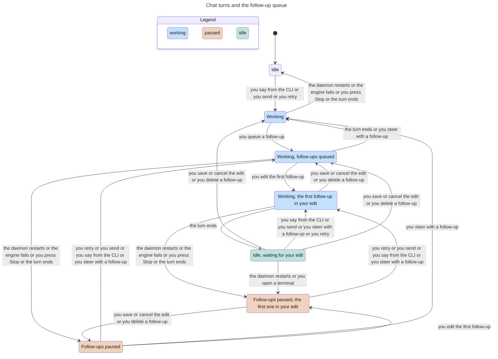

# Chat turns, steering and the queue

Classification: Core. Prerequisites: a configured bot, selected adapter and
daemon.

## Purpose

Let the person steer work now or queue a later request without losing a draft
or silently duplicating a tool action. [Messaging](messaging.md) owns bot input;
this section owns person input, Stop and manual retry. The [ui-shell](ui-shell.md)
owns transcript rendering, attachments and skill pickers; compaction owns its
separate command path.

## Required behaviour

- **R1 — Send and steer.** Owner `POST /sessions/<bot>/<ref>/say` accepts text
  (and supported images). Plain CLI delivery starts an idle turn or steers a
  running one. The app uses durable `{id, mode, text, images?}` input, with a
  lowercase UUID `id` and `mode` `steer` or `followUp`. Nonblank text or images
  is required. Repeating the same id returns its existing item, not a second
  input. The response identifies the actual destination session and item:
  `{session, item?}`, where `session` is the destination UUID and `item`, when
  an item exists, has at least the item's `id` and its R5 `state`; a request
  that creates no item (R2) answers without `item`.
  Accepted app input is stored before dispatch; receipt is not model completion.
- **R2 — Queue.** `followUp` is accepted only during a running turn; otherwise
  it creates no item. At most three queued items per session; a fourth is a
  conflict and keeps the draft. Queue order is acceptance order. The head is
  the first queued item; it is free unless a window holds an edit on it (R3).
  After a successful settlement a free head starts the next turn; a head under
  edit blocks later queued items rather than letting them overtake it. While
  the session is idle, not paused and no terminal holds it
  ([terminal chat](terminal-chat.md) R2, R4), Save or Cancel on the head under
  edit starts that item, and deleting it starts the item after it, now the
  free head, so nothing waits with no reason. Direct steering can proceed
  while the turn is running.
- **R3 — Queue editing.** `POST /sessions/<bot>/<sid>/queue/<id>` accepts
  `action` `edit`, `save`, `cancel`, `delete`, or `steer`; edit/save/cancel use
  a window edit token `edit`, and save/steer can provide replacement text/images.
  Only a still-queued item is editable. Another window's edit token conflicts.
  Save keeps position, Cancel releases the edit without applying the draft,
  Delete cancels that item, and Steer promotes it to immediate input. Empty
  edited content is refused. A stale action reports a conflict, not a new item.
- **R4 — Stop, failure and engine exit.** `POST /sessions/<bot>/<sid>/abort`
  stops the active operation and pauses automatic follow-ups. A failed turn and
  any exit of the engine process do the same without a request. An exit
  includes a deliberate stop (idle timeout, terminal handoff, delete); after
  the stop of an idle engine no input is in flight, so only the pause shows.
  The pause holds only the person's queued follow-ups: bot-origin input
  ([messaging](messaging.md) R6) still dispatches. Retain queued items; an input
  dispatched but not confirmed becomes `delivery_unknown`, and one accepted but
  not dispatched becomes `failed`. Stop is not deletion of the transcript or
  proof an already executed tool was undone. Only the app's deliberate input
  resumes the queue: Send or Steer (R1), Steer on a queued item (R3) and an
  intentional Retry (R6). A plain CLI `say` ([cli](cli.md) R6) runs its own
  turn and leaves the queue paused; when that turn settles no queued item
  starts.
- **R5 — Durable pickup states.** Outbound items expose `accepted`, `queued`,
  `dispatching`, `picked_up`, `handled`, `failed`, `delivery_unknown`, or
  `cancelled` as applicable. Owner session detail lists them as `outbound`, in
  acceptance order, each with at least `id`, `mode`, `text`, `state` and, for a
  failed or uncertain input, `error`. Confirm pickup with a native receipt or transcript
  input id. On daemon restart reconcile those receipts: dispatching without
  confirmation becomes delivery_unknown, accepted without dispatch confirmation
  becomes failed, and automatic queue advancement is paused; a failed turn and
  an engine exit reconcile the same way (R4). Never auto-replay input whose
  pickup is uncertain. A turn's later failure does not erase proof that an
  input was already picked up.
- **R6 — Retry and dismissal.** `POST /sessions/<bot>/<sid>/outbound/<id>/retry`
  takes a new UUID `id`. Only failed/delivery_unknown input is retryable;
  delivery_unknown additionally requires `confirmed: true` after a warning
  that duplicate actions are possible. Cancel the old item and create one
  accepted steering item; repeating the new id is idempotent. Dismiss on
  `/outbound/<id>/dismiss` cancels a failed/unknown notice without resending;
  it cannot discard an in-flight or confirmed-picked-up input.
- **R7 — Recovery boundaries.** Requests resolve engine continuations and move
  only unsent accepted/queued inputs and their owned attachment addresses;
  older transcript text and picked-up records remain with their source.
  Retired attachment addresses produce a recoverable error keeping the edit.
  Terminal-attached sessions (owner session-detail `attached: true` for either
  Pi attachment or Claude ownership) disable Send, person steering, queue
  promotion and Retry, preserving the draft. [Terminal chat](terminal-chat.md) owns Pi mailbox delivery and the
  Claude send-only/queued-incoming ownership boundary; a Claude terminal never
  receives injected incoming messages.
  Compaction cannot be saved or promoted as a queued follow-up; preserve draft.
- **R8 — Recovery copy.** An input that never reached the daemon's ledger must
  survive a reload, a closed window or a daemon that becomes unreachable, so the app writes
  a recovery copy of each person input, and of the queue edit it holds, before
  it sends: input id, mode, text, state, error and every attachment's name,
  type, size and bytes. If that write fails nothing is sent, and the text and
  attachments stay in the composer with the error. If the send then fails, the
  copy returns after a reload as the failed notice of R6. The app writes through
  owner `POST /app-outbox`, body `{scope, action, item?, id?, token?}`, where
  `scope` is `<bot>/<session>` and `action` is one of: `read` (the scope's
  inputs, held edit and draft); `put` (an item with a lowercase UUID `id`, string
  `text` and a `files` list; the same id replaces its earlier copy); `remove`
  (one `id`); `edit` (store the held edit with its edit `token`, or clear it
  with that token; another token is refused while one is held); `draft` (an
  item with string `text` and a `files` list, replacing the scope's draft);
  `delete` (all of the scope's copies and its draft). An item carries a `scope` equal to the request's; an
  `edit` item also carries a UUID `id` and its `token`; an id already held by
  another scope is refused. Any invalid request is a 409 and writes nothing. A
  copy is removed when the ledger shows its input picked up, handled or
  cancelled, when the daemon accepts the send without a ledger item (for
  example a compaction command), and when its session is deleted ([sessions](sessions.md)). When
  the session continues, unsent copies and the held edit follow it with their
  attachment addresses as in R7, so deleting the old session breaks none.
  The daemon keeps one JSON file per scope at
  `<home>/log/app-outbox/<scope, URL-encoded>.json`, plain text a person can
  open in an editor, with the attachment bytes in it, written whole through a
  temporary file and a rename, in a 0700 directory with 0600 files. The scope
  must be two parts of letters, digits, `-` or `_`, 200 characters at most in
  all; a symlinked directory or file is refused. Writers in several windows or
  processes are serialised, and a lock left by a dead process does not block
  them. Nothing outside the home is written and no copy goes anywhere else; the
  files stay out of home history ([home](home.md)).
  The composer's unsent text and attachments are also kept, as the scope's
  draft: every change to them rewrites the draft with `draft` (attachment
  name, type, size and bytes included), and sending empties it. When a
  conversation opens, its draft fills the composer unless a queue edit is held
  or the person has already typed. A failed draft write is not shown and does
  not block typing or sending. The draft belongs to its own scope; it does not
  follow a continued session.

## States

One conversation and its follow-up queue. A CLI `say` starts or steers a turn
like Send but leaves the pause on (R4, [cli](cli.md) R6); the Working states do
not show the pause, so a turn a CLI `say` started from a paused state ends in a
paused state, and Idle includes a paused session with no follow-up. Opening a
terminal pauses held follow-ups, because the handoff stops the idle engine (R4);
otherwise terminal attach and detach are not shown. Not shown: Delete notice
(R6), deleting the only follow-up (the same state without follow-ups), and which
notice an unconfirmed input gets (R4, R5).

## Controls

All repeated controls are scoped to the open conversation or to a queue/notice
region named `Queued message <id>` / `Input notice <id>`, using the durable id.
These accessible names are fixed by this spec, independent of optional keyboard shortcuts.

| Role | Accessible name | Scope, action and observable state |
| --- | --- | --- |
| textbox | Message | Open conversation's multiline composer; draft remains on failed send. |
| button | Send | Sends/steers; disabled if empty or terminal-attached. |
| button | Queue | Adds follow-up, or saves the current queue edit; disabled with no content or no running turn/edit. |
| button | Stop | Interrupts active operation; available during a turn/compaction. |
| button | Edit | Queue card; acquires edit ownership, loads draft. |
| button | Steer | Queue card; promotes; disabled while attached or card held by an edit. |
| button | Delete | Queue card; cancels unsent item; disabled if another window edits it. |
| button | Cancel | Current queue edit; releases edit and restores composer state. |
| button | Retry | Failed/unknown input notice; unknown pickup opens confirmation. |
| button | Delete notice | Failed/unknown input notice; cancels notice only. |
| dialog | Retry message | Explains possible duplicate actions for uncertain pickup. |
| button | Retry | Within Retry message; confirms a new input id. |
| button | Cancel | Within Retry message; closes without resend. |

Empty queue has no card actions. Shared file/image/skill controls are owned by
[ui-shell](ui-shell.md); they are not renamed by this table.

## Edge cases

- **E1 — Failure after acknowledgement.** Preserve streamed reply text and
  durable input status. CLI waiting reports failure, whereas no-wait receipt
  remains only delivery acknowledgement ([cli](cli.md)). A model error or an
  engine exit pauses later follow-ups as Stop does (R4): they are neither
  drained nor left waiting without a notice, and a later Send, Steer or Retry
  in the app resumes them; a CLI `say` does not (R4).
- **E2 — Reload and competing windows.** Reload shows the daemon ledger, plus
  any unfinished recovery copy (R8), rather than inventing another id. Stale
  edits/retries/dismissals conflict; retain the recovery copy and offer its
  error without overwriting another window's edit.
- **E3 — Stop/restart uncertainty.** Show “may already have been picked up”
  where applicable. Neither automatic reconnect nor Stop removes that risk;
  retry needs the person's explicit confirmation.
- **E4 — Isolation of sources.** Person queue edits cannot rewrite bot-origin
  incoming messages. Their dismiss/replay rules are in messaging. Session
  deletion removes its queue and recovery copies as in sessions; daemon
  shutdown alone does not.

| Id | Given | When | Expect |
| --- | --- | --- | --- |
| **T1 — Engine fails before pickup** | Durable Send dispatched; no pickup confirmation | Engine exits, then retry without/with `confirmed: true` and new id | Old input becomes `delivery_unknown` with error, not left accepted/dispatching or auto-replayed. Refuse unconfirmed retry; confirmed retry cancels old item and creates one accepted steer (R4–R6). |
| **T2 — Bounded FIFO edits** | Three follow-ups; head under edit | Add fourth, settle turn, release/delete head; also try idle followUp | Fourth conflicts with draft kept; no overtaking; idle unpaused release/deletion starts free head only without terminal ownership. Idle followUp creates no item (R2, R3). |
| **T3 — Settlement versus queue action** | Queued item | Its Steer/Delete races successful settlement | Only a still-queued item can be claimed; a stale loser conflicts, never creates another input (R2, R3, E2). |
| **T4 — Uncertain restart** | Dispatch held before pickup confirmation, or pickup already confirmed | Daemon restarts | Preserve confirmed pickup; unconfirmed dispatch becomes unknown, no auto-replay; pause advancement (R5). |
| **T5 — Recovery without a live store** | Send/held edit with attachments | Delivery fails before acceptance; reload | Restore failed notice/bytes from per-scope JSON; competing edit token is refused, matching token clears it, dead lock owner cannot block (R8). |
| **T6 — Continuation and retired addresses** | Unsent copies/edit/attachments and uncertain or picked-up records | Continue/delete source; save/promote retired address | Move only unsent copies/edit and owned addresses; uncertain/picked-up records stay. Moved files remain usable; retired addresses refuse, keeping edit (R7, R8). |

Proof: `suite/turns.mjs` uses a held mock turn and reads the API, files and the mock's record, not the window. It checks: a failed turn pausing follow-ups; save, cancel and delete of a held edit; a terminal holding a saved edit; a stopped waiting `say` exiting 1 on each engine; a CLI `say` leaving the queue paused; a restart keeping the queue without replay; a repeated input id; queue races with one winner; a startup failure and Retry; and `log/app-outbox` confinement. Evidence: JSON.