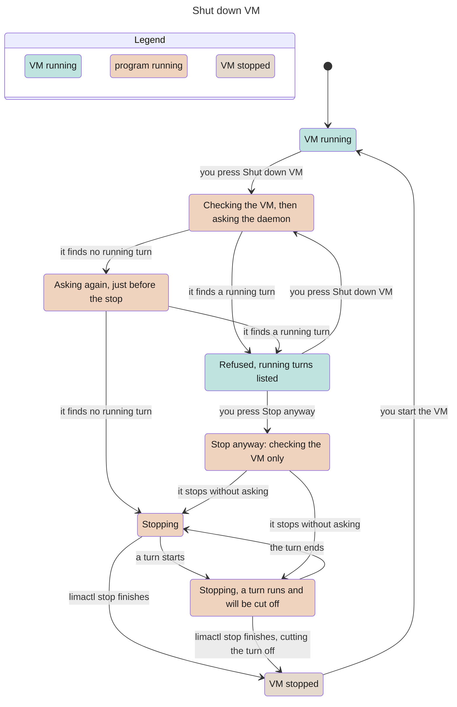

# The supplied VM

Classification: Core. Prerequisites:
[host](host.md), [isolation](isolation.md).

## Purpose

Give a person with no Linux machine of their own a host that meets every
requirement in one pinned step on the Mac: Lima on Apple's virtualization,
Debian 13 arm64, one VM for all bots. This section owns how that VM is
created, sized, connected, started, kept awake, stopped cleanly and removed.
It is the default way to meet the isolation requirement, not the only one. The Mac gets Lima with its start-at-login job, one app, the two SSH
names and, when chosen, the sleep setting; nothing else.

The recipe is [`vm/`](../vm/README.md): the template, the host step and the
environment check.

## Required behaviour

- **R1 — What the VM is.** One Lima instance named `myharness-vm` on `vz`, from
  the Debian 13 arm64 cloud image in the pinned Lima version's image list,
  checked by that list's digest. The base is the image list itself, never a
  Lima template that mounts the Mac home (P6). There are no mounts, no
  containers (containerd off, P8), SSH agent and X11 forwarding off, and only
  Lima's own key loaded, never the person's `~/.ssh` keys. The template carries
  the packages the harness, the kit and the bots need (Git, the GitHub CLI,
  curl, rsync, sqlite3, jq, Xvfb, xauth and Electron's runtime libraries) and
  installs them without recommended extras (P15); bots cannot install packages
  later ([isolation](isolation.md) R2). Every root step runs at every boot and
  is written check-then-act; every file is written to a temporary name,
  validated, then renamed (P2), and root-managed files are rewritten from the
  template at boot, so drift inside the VM resets on restart. Creation reports
  ready only after provisioning and a readiness probe (egress rule active, bot
  user present) pass, so a broken provision fails at creation, not later.
- **R2 — Pins and where their hashes come from.** Every third-party input is
  an exact version, and a version change is a reviewed change on its
  own.
  - Lima: the release archive from Lima's GitHub release, checked against that
    release's SHA-256 list, installed under `~/.local` with neither Homebrew
    nor sudo; a different `limactl` already on the PATH is bypassed by its
    absolute path.
  - The recipe: fetched from `Build-Pilled/BYOH` at the release named in the
    [top-level README](../README.md#release). Check the SHA-256 of `vm/SHA256SUMS`
    against that README, then check the template, host step and environment check against
    `SHA256SUMS` before running them.
  - Node: the exact pinned version from the official Node build for
    the VM's architecture, checked against that release's `SHASUMS256.txt`,
    installed root-owned outside the bot home and never changed by automatic
    updates.
  - Engines: the selected engines at their pinned versions with automatic
    updates off ([engine Pi](engine-pi.md), [engine Claude Code](engine-claude-code.md)).
  - The interview tool and the desktop app's build tools: as pinned in
    [onboarding](onboarding.md) R3 and [app build](app-build.md) R4.
  - Debian packages come from Debian stable and its security archive and are
    not pinned within the release: security updates install automatically,
    reboots stay manual. The environment check reports versions, so drift
    shows.
- **R3 — Sizing.** Memory comes from this table by the Mac's RAM, not one size
  for everyone. The setup agent pre-selects the row for the Mac and
  shows the table; the default is one click. An 8 GB Mac is not
  recommended; if the person insists it gets 3 GB and is told to stop the VM
  when idle.

  | Mac RAM | VM memory | Left for the Mac | Bots working at once |
  | --- | --- | --- | --- |
  | 8 GB | not recommended (3 GB if insisted) | 5 GB | 1-2 |
  | 16 GB | 4 GB | 12 GB | 2-4 |
  | 24 GB | 6 GB | 18 GB | 4-8 |
  | 32 GB | 8 GB | 24 GB | 8-12 |
  | 48 GB or more | 8 GB, raised only on need | 40 GB or more | 8-12 |

  CPUs are half the Mac's cores, at least 2 and at most 6. The VM holds the
  memory it has touched while it runs and gives none back to the Mac; Linux
  fills spare memory with file cache, so over time the VM is charged its full
  size. Memory is sized to what programs need, because anything above that
  becomes cache. Changing it is the person's action: stop the VM, run
  `limactl edit --memory <GiB> myharness-vm`, start it again. The system disk is
  100 GiB sparse: the file on the Mac grows with use, never shrinks on its own
  and is capped at 100 GiB (P3). Swap is 4 GiB; inotify limits are raised for
  recursive watchers (P32).
- **R4 — Disks.** The default is one disk: the harness home lives on the system
  disk, and deleting the VM deletes the harness data unless
  [VM backup](vm-backup.md) was chosen. A separate data disk for the
  bot home is a choice asked in the host step, before creation, only after the
  agent explains it: for it, the home survives deleting or rebuilding the VM;
  against it, a second disk file on the Mac that only grows, a late mount that
  needs start guards, and a name limit that otherwise reformats the disk at
  every boot. With the data disk, its name is `mhhome` (11 characters at most,
  P1) and the recipe refuses any other; services that need the home check that
  it is mounted before starting and retry on failure without a start limit,
  and nothing blocks boot on it (P13); the file system's creation time is
  recorded at creation and compared at every check (P1). Switching layouts
  later is a migration the person asks for, never automatic.
- **R5 — Forwards and SSH names.** Lima forwards exactly three ports from the
  VM's loopback to the Mac's 127.0.0.1: 7797 (daemon UI and API), 4388 (the
  interview pages) and 1455 (Pi's sign-in callback, which listens only during a
  Pi login); a final rule ignores every other port on every guest
  address, TCP and UDP (P10). Claude Code's sign-in pastes a code and needs no
  port. Lima's SSH port on the Mac is fixed when the VM is created, so the SSH
  names survive restarts. The host step writes `~/.ssh/myharness.conf` with two
  names, `myharness` (the bot user) and `myharness-admin` (Lima's admin user),
  each with Lima's key, its port, agent forwarding off and connection sharing
  off, and adds one `Include ~/.ssh/myharness.conf` line at the top of
  `~/.ssh/config` (created 0600 when absent, edited through a temporary file).
  These are the [host](host.md) R3 names for this VM.
- **R6 — Accounts.** The bot user is `myharness`, UID 1500, with its own group,
  a locked password, no sudo, Lima's key in its authorized keys, and linger on
  so its services run without a login. Its home is mode 0700 and is never
  loosened (P30). The admin is Lima's default user, named after the Mac user,
  with password-less sudo; admin steps run with umask 022 and act as the bot
  user (`runuser`) for anything the bot owns (P29).
- **R7 — Services.** The daemon is the system service `myharness.service`
  running as the bot user from the deployed build ([app build](app-build.md)
  R1), installed and changed only by the admin. It starts only
  when the egress unit is active (and, with a data disk, when the home is
  mounted), restarts on failure, stops with its own drain within 15 seconds,
  has a memory ceiling of five eighths of the VM's memory rounded down to whole
  GiB and a task limit of 4096, and has `/usr/local/bin` on its PATH, where the
  root-owned `myharness` launcher lives ([host](host.md) R6). The bot user's
  service manager also refuses to start without the egress unit. The host jobs
  of [host](host.md) R7 are systemd timers with catch-up after a missed run.
  Security updates install from Debian's daily timers.
- **R8 — Start at login and sleep.** The VM starts when the person logs in to
  the Mac (`limactl autostart enable myharness-vm --condition=login`), and with it
  the daemon. A VM the person stopped stays stopped until the next login or an
  explicit start; start at login never restarts it behind their back. The host
  step offers macOS's setting to prevent automatic sleep on the power adapter
  while the display is off, pre-selected, with one line saying why: a
  sleeping Mac pauses the VM, so bots stop and routines are logged as missed,
  not run late (P28). On battery the Mac sleeps normally; the person can undo
  the setting in System Settings.
- **R9 — Clean stop.** The clean-stop program ships inside the desktop app
  ([app pairing](app-pairing.md) R10 runs it; it also runs from Terminal). It
  takes no argument, or `--force`. Its steps, in order:
  1. `check`: `limactl` at its recorded absolute path and the instance
     `myharness` exist; otherwise it fails.
  2. `already`: if the instance is already stopped it prints
     `result: already-stopped` and exits 0.
  3. `ask` (skipped only with `--force`): it asks the daemon at
     `http://127.0.0.1:7797` for `GET /bots` with the app's paired token, read
     inside the program and never placed in an argument list, with a 5-second
     limit. A refused connection means no daemon and nothing running. Each
     live session reported as running prints `busy: <bot>/<session>` to
     standard error, and the program exits 3. A timeout or a 401 also exits 3,
     with `busy: unknown (<reason>)`, because it cannot tell.
  4. `ask again` (skipped only with `--force`): immediately before stopping it
     asks once more exactly as in step 3, with the same outcomes.
  5. `stop`: it runs `limactl stop myharness-vm` and streams its output, with no
     shorter limit of its own; inside the VM the service manager stops the
     daemon with its drain.
  6. `stopped`: when the instance reports stopped it prints `result: stopped`
     and exits 0.

  A failure in any step prints `reason: <text>` to standard error and exits 1;
  an unknown argument exits 2. `--force` skips only `ask` and `ask again`; it
  never forces the VM off (`limactl stop --force` is the person's recovery for
  a Broken instance, P5). The daemon keeps accepting turns until its drain: a
  turn that starts in the seconds between `ask again` and the drain is
  interrupted by the stop, and after the next start its input shows that it
  may already have been picked up ([turns](turns.md) R5, E3), or as picked up
  when its pickup was already confirmed. On an own host there is no clean-stop
  program action ([settings](settings.md) R5, [host](host.md) R8).
- **R10 — The one habit.** Before a logout, restart, shutdown or macOS update
  the person stops the VM, with Shutdown VM in Settings or
  `limactl stop myharness-vm`. Otherwise macOS hard-stops the guest (P4):
  running turns are interrupted, the file system and SQLite recover at the next
  boot, and the environment check reports the recovery as INFO. After a Mac
  crash the instance may show Broken (P5); the person runs
  `limactl stop --force myharness-vm`, then `limactl start myharness-vm`.
- **R11 — Removal.** Trying it and judging is supported. Removal turns
  off start at login, deletes the instance, removes Lima's files under the Mac
  home and the `~/.local` install, the SSH file and its `Include` line, the
  app and its support folder. Removal states first, in the person's words, that
  deleting the VM deletes the harness data unless backup was chosen or the
  data disk is kept ([VM backup](vm-backup.md) R2).

## States

The clean-stop program started by Shut down VM (R9). Not shown: an already
stopped VM, which ends at `already` with exit 0, failures (exit 1) and the
daemon going down by itself.

## Controls

Not applicable; Shutdown VM's controls belong to [settings](settings.md).

## Edge cases

- **E1 — Busy Mac port.** Ports 7797, 4388 or 1455 held on the Mac stop the
  host step before creation (P24); the fixed ports are not changed silently.
- **E2 — Existing instance or Lima-wide configuration.** An instance already
  named `myharness-vm`, or a Lima-wide default or override file, stops the host
  step and is shown to the person; nothing is replaced (P7).
- **E3 — Hash mismatch.** A Lima archive, template or Node build that does not
  match its pinned hash stops the step with nothing installed.
- **E4 — Dated image gone.** When Debian removes the dated image, Lima falls
  back to its daily image; creation continues and the environment check warns.
- **E5 — Stopped on purpose.** A VM stopped with Shutdown VM stays stopped
  through app relaunches; the app shows the unreachable state, not an error.
- **E6 — Busy at shutdown.** A busy refusal leaves the VM running and lists the
  turns; only an explicit Stop anyway passes `--force`, which interrupts them.

| Id | Given | When | Expect |
| --- | --- | --- | --- |
| **T1 — Clean-stop protocol and force boundary** | Supplied VM or owned limactl/daemon stand-ins and clean-stop program | Run ordinary or explicit --force stop through documented exits | Check the recorded program/instance; already stopped returns result already-stopped/0. Ordinary asks twice; busy, timeout or401 refuse3, refused connection means absent daemon. Force skips only both asks, never forces Lima off. Stop streams until instance stopped/result stopped/0; failures print reason/1, unknown arg2. Token stays inside process, never argv (R9, E6; [app pairing](app-pairing.md) R10). |
| **T2 — A turn between asks refuses stop** | First ordinary ask sees idle; a turn begins before the second ask | Read ask-again result and instance state | Exit3 with busy line naming that turn, leaving VM running; no stop invocation. The second check is immediately before stop, not a promise that no later turn can start (R9, E6). |
| **T3 — Late input keeps honest pickup status** | A routine input starts after final ask and before drain, with pickup not confirmed | Complete stop and restart the owned rehearsal instance | Stop may interrupt it: unconfirmed pickup is possibly-picked-up/delivery_unknown and is not replayed automatically. Already confirmed pickup stays known as picked up, not forcibly uncertain; do not claim completion merely because stop finished (R9; [turns](turns.md) R5, E3). |
